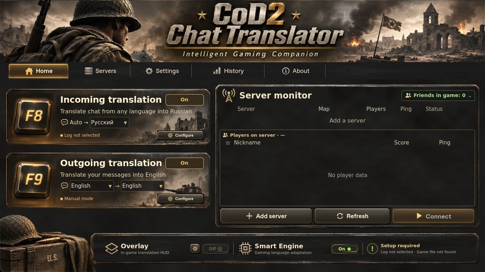
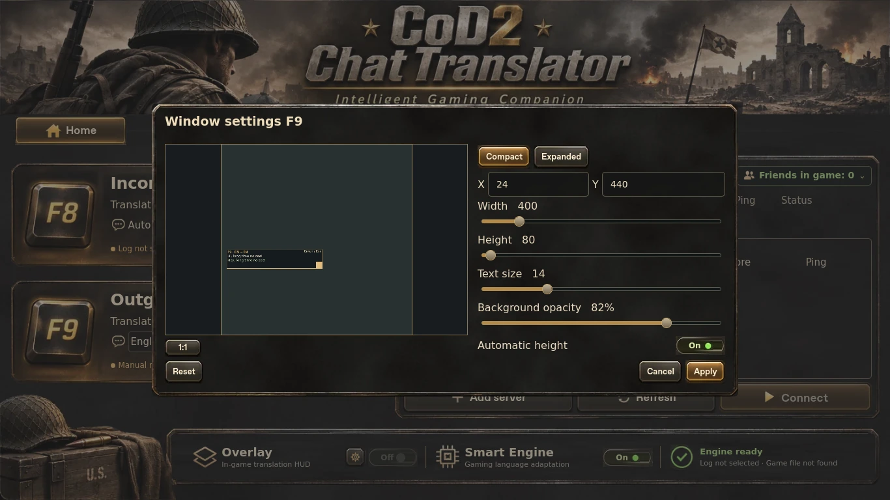
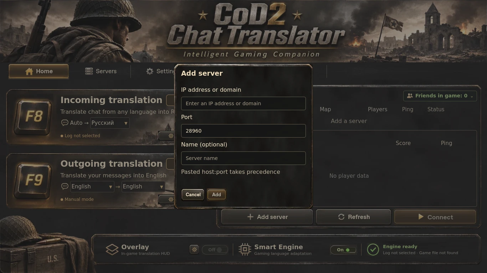

# CoD2 Chat Translator

[English](README.md) · [Русский](README_RU.md) · [Українська](README_UK.md)

**Windows release candidate 1.22.0**

Translate chat while playing Call of Duty 2, reply in another language and see when your friends join a server.

[Download the published Windows release](https://github.com/kriskarter/cod2-chat-translator/releases/latest) · [GitHub Releases](https://github.com/kriskarter/cod2-chat-translator/releases)

## Install and connect the game

Open Assets on the release page and download the Windows x64 installer. Choose a language and folder. The last screen offers a desktop shortcut. Start multiplayer, then open Settings → Profiles. Select the active profile or browse for console_mp.log. If logging is off, enable it and follow the prompt to restart the game. Choose the incoming target language on Home and the source and target for replies.

## Game controls

| | |
|---|---|
| **F8** | Toggle incoming translation |
| **F9** | Open the outgoing message window |
| **Enter** | Send the translated reply when ready |
| **Esc** | Cancel input |
| **F10** | Save a game screenshot and display its path |

## Adjust the HUD

Select Configure on the F8 or F9 card. Drag the frame on the monitor diagram and adjust its size, font and opacity. Apply each window’s settings separately. Compact F9 leaves more of the game visible. Expanded mode gives long messages more room.

## Chat and history

Smart Engine recognises gaming expressions such as gg and ns using the selected style and context. Online translation needs internet access. Links, email addresses and server addresses retain their spelling. Search History by player or message, filter by direction, copy a line or export before quitting. The session holds up to 200 messages. Clearing history removes them immediately.

## Servers and friends

Select Add server. Enter the host and port separately or paste a full address such as example.com:12345. The default port is 28960. A name is optional. Select a server to see its map, ping, player count and roster. Mark favourites and add player nicknames to Friends for presence notifications while the monitor runs.

## Updates and saved settings

Open About to check for updates. The candidate checks the stable channel. On first launch it imports compatible settings from the old stable and preview profiles. Existing stable Qt settings take precedence. Keep the original profiles and the before-1.22 backup until you have checked your friends, servers and both HUDs.

## Troubleshooting

For missing incoming chat, check F8 and whether the selected log receives new lines. For F9, focus the game, check the outgoing switch and compare Windows privileges. Use the built-in UAC prompt if needed. If a server appears offline, check its address and query port. Retry translation when internet access returns. SmartScreen may warn about an unsigned installer. Check the download source and compare its SHA-256 with the release manifest.

[Gallery](docs/images/stable_release/en/README.md)

[If the app helps you, give the project a star on GitHub.](https://github.com/kriskarter/cod2-chat-translator)

Unofficial player utility by kriskarter. Unaffiliated with Activision.

[Report an issue](https://github.com/kriskarter/cod2-chat-translator/issues) · [Copyright](COPYRIGHT.md) · [Third-party notices](THIRD_PARTY_NOTICES.txt)
