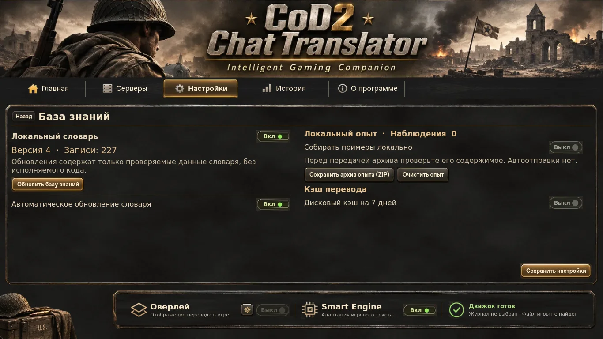

# CoD2 Chat Translator

[English](README.md) · [Русский](README_RU.md) · [Українська](README_UK.md)

**Кандидат версии 1.22.0 для Windows**

Читайте сообщения иностранных игроков в Call of Duty 2, отвечайте им прямо в игре и узнавайте, когда друзья заходят на сервер.

[Скачать опубликованную версию для Windows](https://github.com/kriskarter/cod2-chat-translator/releases/latest) · [GitHub Releases](https://github.com/kriskarter/cod2-chat-translator/releases)

## Установка и первый запуск

На странице релиза раскройте Assets и скачайте установщик Windows x64. Выберите язык и папку. На последнем экране можно создать ярлык рабочего стола. Запустите сетевую CoD2 и откройте «Настройки» → «Профили» в переводчике. Выберите активный профиль или укажите console_mp.log вручную. Если игра не ведёт журнал, включите запись и следуйте подсказке о перезапуске игры. На главной выберите язык входящего перевода и языковую пару для ответов.

## Клавиши в игре

| | |
|---|---|
| **F8** | Включить или выключить входящий перевод |
| **F9** | Открыть окно ответа |
| **Enter** | Отправить ответ после завершения перевода |
| **Esc** | Отменить ввод |
| **F10** | Сохранить снимок игры и показать путь к файлу |

## Как настроить игровые окна

Нажмите «Настроить» на карточке F8 или F9. Перетащите рамку на схеме монитора, измените размер, шрифт и прозрачность. Примените параметры каждого окна отдельно. Компактный F9 оставляет больше места для игры. В расширенном режиме удобнее читать длинные реплики.

## Перевод и история

Smart Engine учитывает игровой сленг, например gg и ns, выбранный стиль и контекст. Для сетевого перевода нужен интернет. Ссылки, электронные адреса и адреса серверов сохраняют исходное написание. В истории можно искать по нику или тексту, фильтровать входящие и исходящие, копировать и экспортировать сообщения. В памяти хранятся до 200 сообщений текущего сеанса. Сохраните нужные реплики до выхода или очистки истории.

## Серверы и друзья

Нажмите «Добавить сервер». Укажите адрес и порт раздельно или вставьте строку целиком, например example.com:12345. Порт по умолчанию 28960. Название можно пропустить. Выберите сервер, чтобы увидеть карту, число игроков, пинг и состав. Отмечайте избранные серверы и добавляйте ники в друзья, чтобы получать уведомления о появлении игроков во время мониторинга.

## База знаний и локальный опыт

Откройте «Настройки» → «База знаний». Общий словарь переводит проверенные реплики без интернета. Автообновление словаря при запуске можно отключить. Чтобы накапливать примеры на своём ПК, включите сбор. Для передачи в ChatGPT нажмите «Сохранить архив опыта (ZIP)», выберите папку и проверьте содержимое. Дисковый кэш хранит подходящие переводы семь дней.

## Обновление и перенос настроек

Проверка обновлений находится в разделе «О программе». Кандидат проверяет стабильный канал. При первом запуске импортируются совместимые настройки прежней стабильной версии и принятого Preview. Если стабильный профиль уже содержит настройки Qt, сохраняются они. Оставьте исходные профили и резервную папку before-1.22, пока не проверите серверы, друзей и параметры обоих окон.

## Если что-то не работает

Если чат пуст, проверьте F8, выбранный журнал и появляются ли в нём новые строки. Если F9 не открывается, верните фокус игре, проверьте переключатель исходящего перевода и права обоих приложений. При необходимости используйте штатный запрос UAC. Если сервер офлайн, уточните адрес и порт опроса. После потери интернета повторите перевод, когда связь восстановится. Windows может показать SmartScreen для неподписанного установщика. Проверьте источник загрузки и сравните SHA-256 файла с опубликованной суммой.

[Галерея](docs/images/stable_release/ru/README.md)

[Если программа пригодилась, поддержите проект звездой на GitHub.](https://github.com/kriskarter/cod2-chat-translator)

Неофициальная утилита для игроков от kriskarter. Проект не связан с Activision.

[Сообщить об ошибке](https://github.com/kriskarter/cod2-chat-translator/issues) · [Авторские права](COPYRIGHT.md) · [Third-party notices](THIRD_PARTY_NOTICES.txt)
