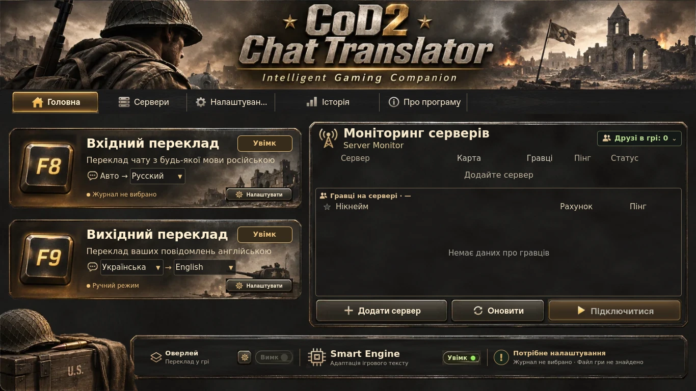
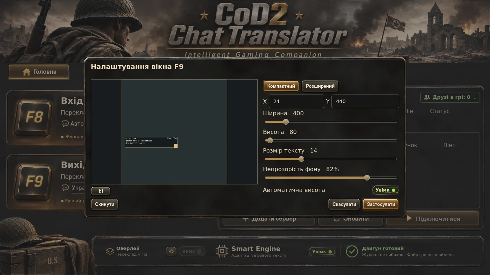
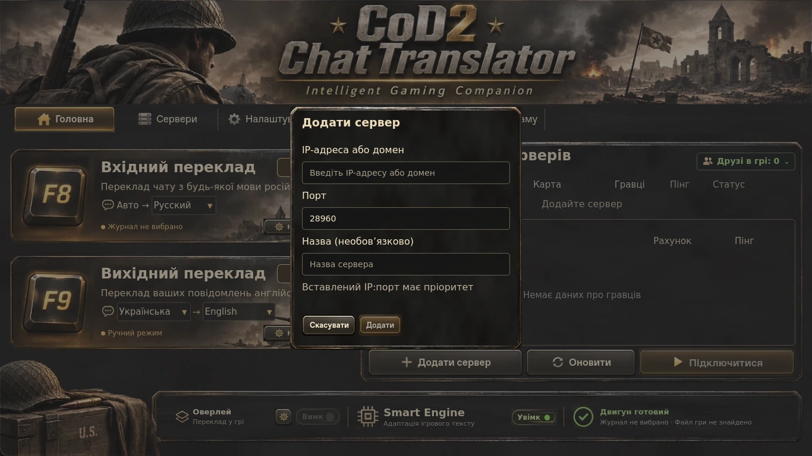

# CoD2 Chat Translator

[English](README.md) · [Русский](README_RU.md) · [Українська](README_UK.md)

**Кандидат версії 1.22.0 для Windows**

Читайте повідомлення іноземних гравців у Call of Duty 2, відповідайте їм під час гри й дізнавайтеся, коли друзі заходять на сервер.

[Завантажити опубліковану версію для Windows](https://github.com/kriskarter/cod2-chat-translator/releases/latest) · [GitHub Releases](https://github.com/kriskarter/cod2-chat-translator/releases)

## Встановлення й перший запуск

На сторінці випуску розгорніть Assets і завантажте інсталятор Windows x64. Виберіть мову й теку. На останньому екрані можна створити ярлик на робочому столі. Запустіть мережеву гру CoD2. У перекладачі відкрийте «Налаштування» → «Профілі», виберіть активний профіль або вкажіть console_mp.log вручну. Якщо гра не веде журнал, увімкніть запис і виконайте підказку щодо перезапуску гри. На головній виберіть мову вхідного перекладу та мовну пару для відповідей.

## Клавіші у грі

| | |
|---|---|
| **F8** | Увімкнути або вимкнути вхідний переклад |
| **F9** | Відкрити вікно відповіді |
| **Enter** | Надіслати відповідь після завершення перекладу |
| **Esc** | Скасувати введення |
| **F10** | Зберегти знімок гри й показати шлях до файлу |

## Налаштування ігрових вікон

Натисніть «Налаштувати» на картці F8 або F9. Перетягніть рамку на схемі монітора, змініть розмір вікна, шрифт і прозорість. Застосуйте налаштування окремо для кожного вікна. Компактний режим F9 залишає більше місця для гри. У розгорнутому зручніше читати довгі повідомлення.

## Переклад та історія

Smart Engine розпізнає ігровий сленг, зокрема gg та ns, і враховує вибраний стиль та контекст. Для мережевого перекладу потрібен інтернет. Посилання, електронні адреси й адреси серверів зберігають початкове написання. В історії можна шукати за ніком або текстом, фільтрувати повідомлення за напрямком, копіювати й експортувати їх. У пам’яті зберігаються до 200 повідомлень поточного сеансу. Експортуйте потрібні репліки, перш ніж вийти з програми чи очистити історію.

## Сервери й друзі

Натисніть «Додати сервер». Вкажіть адресу й порт окремо або вставте повну адресу, наприклад example.com:12345. Стандартний порт — 28960. Назву можна пропустити. Виберіть сервер, щоб побачити карту, кількість гравців, пінг і список учасників. Позначайте улюблені сервери й додавайте ніки до друзів, щоб отримувати сповіщення про появу гравців під час моніторингу.

## Оновлення й перенесення налаштувань

Перевірка оновлень є в розділі «Про програму». Кандидат перевіряє стабільний канал. Під час першого запуску імпортуються сумісні налаштування попереднього стабільного випуску та прийнятої версії Preview. Якщо стабільний профіль уже має власні налаштування Qt, програма їх збереже. Залиште початкові профілі й резервну теку before-1.22, доки не перевірите сервери, друзів і обидва ігрові вікна.

## Як усунути поширені проблеми

Якщо чат порожній, перевірте F8, вибраний журнал і чи з’являються в ньому нові рядки. Якщо F9 не відкривається, поверніть фокус грі, перевірте перемикач вихідного перекладу й права обох програм. За потреби скористайтеся штатним запитом UAC. Якщо сервер поза мережею, уточніть адресу та порт опитування. Після зникнення інтернету повторіть переклад, коли зв’язок відновиться. Windows може показати SmartScreen для непідписаного інсталятора. Перевірте джерело завантаження та порівняйте SHA-256 файлу з опублікованою сумою.

[Галерея](docs/images/stable_release/uk/README.md)

[Якщо програма стала вам у пригоді, підтримайте проєкт зіркою на GitHub.](https://github.com/kriskarter/cod2-chat-translator)

Неофіційна утиліта для гравців від kriskarter. Проєкт не пов’язаний з Activision.

[Повідомити про помилку](https://github.com/kriskarter/cod2-chat-translator/issues) · [Авторські права](COPYRIGHT.md) · [Third-party notices](THIRD_PARTY_NOTICES.txt)
