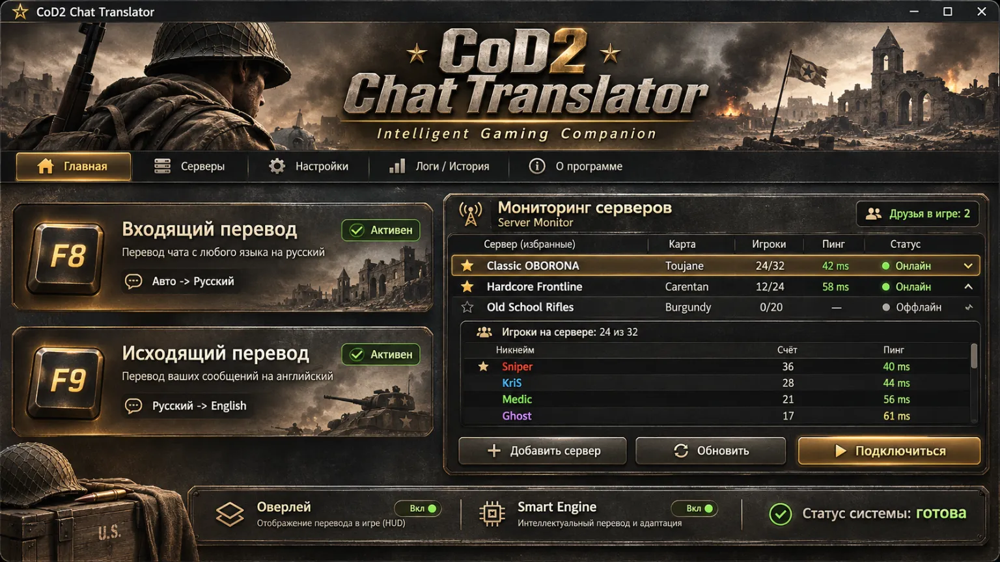
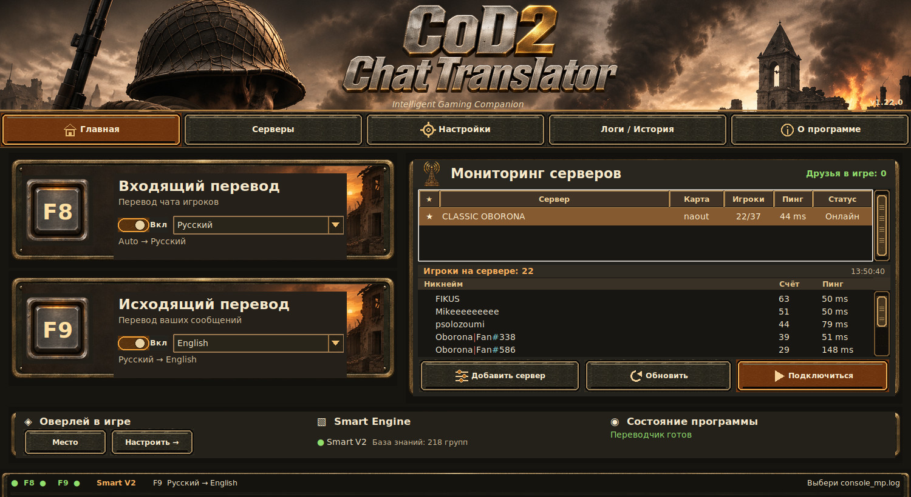

# CoD2 Chat Translator — художественная доводка PR #8

Композиция согласованного командного центра сохранена. Баннер теперь показывает
верх каски и церковь целиком; логотип остаётся отдельным прозрачным ресурсом.
Клавиши F8/F9 — фокусируемые живые контролы с иллюстрированной сталью и
состояниями наведения/нажатия. Рамки главных карточек, монитора, серверных
настроек и нижней панели рисуются девятью сегментами, поэтому уголки и заклёпки
не растягиваются. Переключатели и выпадающие списки связаны с текущей
конфигурацией. Список игроков содержит отдельные колонки никнейма, очков и
пинга с исходными цветовыми кодами CoD2.

| Утверждённый эталон | Запущенная программа, Linux/Xvfb 1500×820 |
| --- | --- |
|  |  |

[Мониторинг серверов](images/server_monitor_rc/xvfb_servers_artpass.png) ·
[Расширенные настройки перевода](images/server_monitor_rc/xvfb_translation_artpass.png).

Графические исходники: `assets/ui_premium/keycap_source.png`,
`translation_card_source.jpg`, `radio_source.png`, а также ранее созданные
`generic_panel.png` и `monitor_hero.png`. Контролы, серверные строки, имена,
числа, переключатели и действия остаются частью работающего приложения.

Проверка: 222 unit-теста прошли, один пропущен. Xvfb smoke 1500×820 проверил
RU/UK/EN, переключение F8/F9, страницы, настройки и состояние оверлея. Высота
главной страницы 526 пикселей при доступных 530: прокрутка на этом размере
не требуется. Это снимки Linux, не Windows. Нативные DPI Windows,
установка RC, действия внутри настоящей CoD2 и уведомления друзей требуют
отдельного испытания на Windows; окончательная художественная оценка за владельцем.
