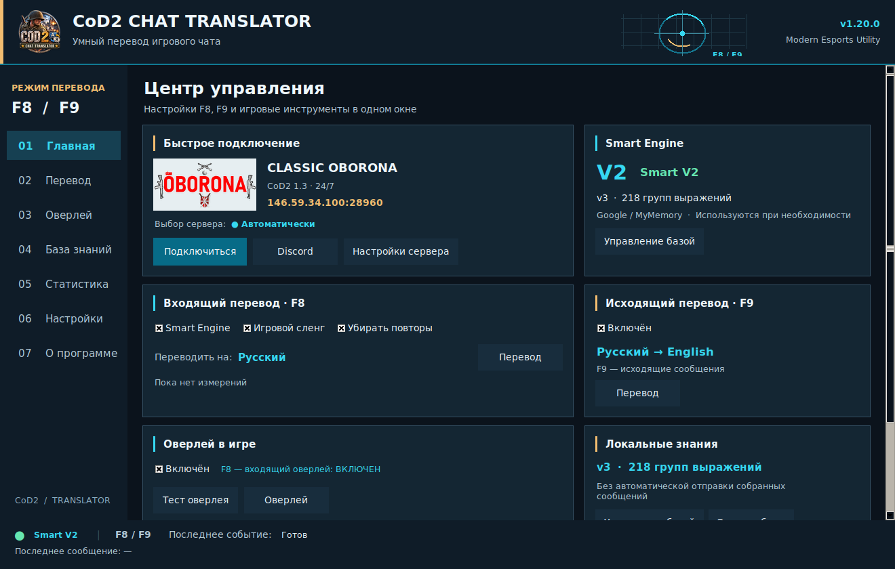

# CoD2 Chat Translator v1.20.0 RC — Modern Esports Utility

This is the **real implemented Windows desktop interface**, not a generated concept.

## Approved design

- Graphite esports/military-technology look, original cyan HUD artwork, amber tactical accents, readable Segoe UI typography and keyboard-focus indicators.
- Existing brand/logo and preconfigured CLASSIC OBORONA quick-connect unchanged. The address is a featured server preset, not a claim that the server is currently online.
- Live data only: active mode comes from Smart/V2 flags; knowledge version and group count from the in-memory pack; F8 provider p50/p95 from existing real samples; latest event from existing status and last-message variables. No fabricated ping, FPS, accuracy, cache size or service connectivity values.
- All screens use real Tk/ttk widgets and original callbacks. No screenshot is used as a clickable background.

## Navigation (working controls)

| Section | Purpose |
| --- | --- |
| Home | Featured server, Smart state, F8/F9 summary, overlay, knowledge and common actions |
| Translation | Incoming F8 target, Smart/slang/style/original/dedupe; outgoing F9 source/target and activation; measured F8 timings |
| Overlay | Enabled state, size/background/duration sliders, message count, live flags, presets, edit/lock, test, clear, screenshot F10 and CoD2 borderless |
| Knowledge | V2 enable, auto update, opt-in local examples/cache, manual ZIP export and clear |
| Statistics | Measured F8 queue/provider latency and optional persisted F8/F9/UI samples, refreshed asynchronously |
| Settings | Server/profile setup, RU/UK/EN language, update check, borderless game window, About |
| About | Existing localized application dialog |

Sidebar buttons support keyboard focus, long pages are scrollable, and switching language preserves window size and active section. All saved settings use the existing configuration.

## What remains unchanged

- Incoming CoD2 log parser, F8 worker pool, original/hidden/same-language handling, Smart V1/V2 and safety checks
- Outgoing F9 game keyboard hooks, translation popup, style/slang/target selection
- Server discovery, profile naming, quick-launch and Discord, original overlay fade/hotkeys/topmost
- Opt-in local SQLite experience and data-only knowledge pack update. Never auto-uploads chat
- Windows installer and stable release gates

## Test evidence / limitations

- Automated tests cover dashboard structure, localization parity, callback preservation, color contrast and actual-source status display.
- Real Tk 8.6 GUI exercised in isolated X11 environment, with Python Tk runtime files unpacked for the test only. The script tools/dashboard_smoke.py tested six pages, real knowledge collection and overlay controls, Smart mode, RU/UK/EN switching, preserved page/geometry and a 1050x690 window. Screenshot was taken from that actual running window without mouse cursor.
- Test command on a computer with Tk and an X11 display: xvfb-run -a python tools/dashboard_smoke.py --screenshot /tmp/dashboard.png
- Manual Windows/CoD2 test is STILL REQUIRED for native DPI scaling, game-focus F8/F9, full-screen overlay, actual server profile, F10 screenshot, knowledge export and persistence.
- Design changes do not fix network latency or guarantee correct translation of unknown slang. Speed metrics remain synthetic where previously labeled.

## Release and rollback

The new UI remains on a feature/RC branch. Stable main and prior published installer are not merged or replaced. Rollback requires reinstalling the previous stable installer without deleting personal local experience. GUI source is dashboard_ui.py; core backend in app.py remains in place.
