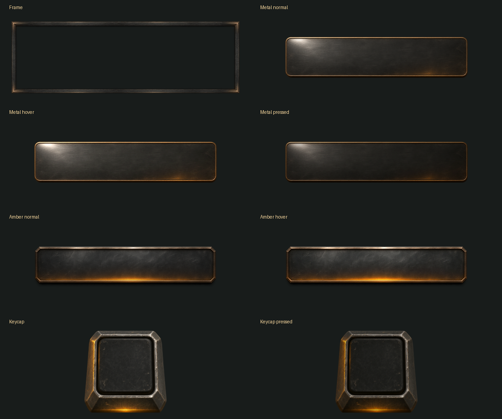
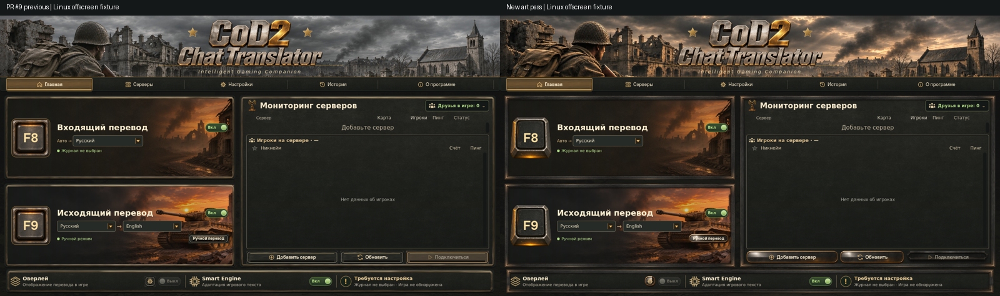

# Qt artistic component pass — PR #9

The approved `docs/images/server_monitor_rc/reference.png` remains the artistic target. The four new sources below were generated as **separate components**, not a screenshot or a full UI background. QML retains all live text, controls, tables, focus and event handlers. Source files live in `assets/qt_art/source/`; optimized runtime files live in `qt_experiment/art/`. Rebuild the runtime copies with `python tools/build_qt_art_assets.py` (Pillow at build time only).

| Source | Runtime size / alpha | Slice / states | Usage |
| --- | --- | --- | --- |
| `frame.png` | 600×190 RGBA | 23 px left/right; 20 px top/bottom | `ArtFrame`, all `MetalPanel` surfaces and internal `MetalDialog` |
| `metal_button.png` | 400×90 RGBA | 20 px left/right; 18 px top/bottom; normal, hover, pressed, focused, disabled | `MetalButton` throughout |
| `amber_button.png` | 400×90 RGBA | same five states | `AmberButton`, especially Connect |
| `keycap.png` | 240×240 RGBA | no slicing; same five states | `KeycapButton` for F8/F9 |
| `panorama_warm.png` | 2172×292 RGB source; optimized JPEG runtime | fixed header crop | `Home.qml` shared panorama on every page |

Original generated component RGBA files are kept as source. Variants are preprocessed once at build time, not modified on state changes. The key labels and button text are rendered by Qt. The panorama was generated as a warmer composition preserving the soldier, church and empty central logo area; its separate logo remains live QML. Existing translation scenes, radio art, logo, SVG icons and compact switches remain in use; replacing those without better matching art would reduce consistency.

## Visual audit and iteration

The approved reference uses a warm cinematic panorama, restrained thin metal edges, a single continuous navigation rail, luminous keys, softly highlighted table rows and compact lower controls. The previous Qt build had correct page geometry and functional controls but its frame had squared, repeated trim and its keys lacked the reference's perspective and light. The new shared frame and keys improve material depth, while the generated button plates unify actions across workspaces and dialogs. The new warmer panorama improves cohesion with the reference. These are local improvements, **not a claim of pixel or artistic equivalence**: F8/F9 cards are still more orange, and sparse live server data cannot resemble the populated reference without real servers. The navigation rail, icon family and switch art were retained, pending a stronger matching replacement.

Actual application screenshots for all 11 pages: [home](images/qt_art_pass/home.png), [servers](images/qt_art_pass/servers.png), [settings](images/qt_art_pass/settings.png), [outgoing](images/qt_art_pass/outgoing.png), [overlay](images/qt_art_pass/overlay.png), [profiles](images/qt_art_pass/profiles.png), [knowledge](images/qt_art_pass/knowledge.png), [notifications](images/qt_art_pass/notifications.png), [stats](images/qt_art_pass/stats.png), [history](images/qt_art_pass/history.png), [about](images/qt_art_pass/about.png). These captures use an empty **fixture** for servers and game data, and are from Linux offscreen Qt, not native Windows or gameplay. CI separately captures native Windows frozen EXE pages, dialogs and scale matrix.

## Checks and limits

- `pytest`: 246 passed, 3 skipped; 57 subtests passed.
- Linux offscreen process to first saved frame, four runs on this shared host: before median 1032.5 ms, after median 921.1 ms. Observed peak RSS: 127.6 versus 128.5 MiB. These short runs do not measure steady idle CPU, GPU, scrolling, real network latency, Windows DPI or game FPS.
- The generic Linux offscreen font fallback now selects an installed face with Cyrillic glyphs when its generic default lacks them. Windows still uses its existing font path.
- Native CoD2 F8/F9/F10, fullscreen HUD, gameplay performance, actual Windows DPI and updater installation require a real owner-authorized Windows game session. A Windows CI screenshot cannot establish these facts.

Generation prompt set: a thin transparent dark graphite WWII command panel frame; an empty dark graphite steel action button; an empty restrained amber steel action button; an empty square graphite keycap with low amber base light; a color and light edit of the original wide panorama using the approved reference as style guidance. All were made with the built-in image generator, with no raster UI text. Human artistic acceptance remains with the owner.
