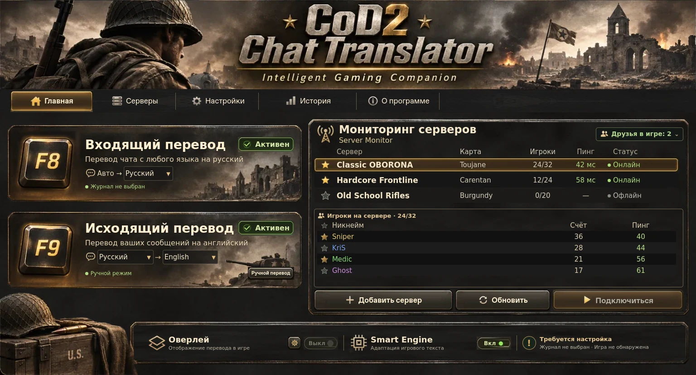

# CoD2 Chat Translator · финальная полировка Qt RC

[Главная](images/final_polish/home.webp) · [сравнение восьми областей с исходником](images/final_polish/components.webp) · [открытые списки и поля](images/final_polish/controls.webp)

## Визуальная приёмка

Для проверки исходных дефектов использованы восемь снимков владельца от 27 ноября и оригинал 1536 × 864. Контрольное окно занимает 1536 × 830 без системного заголовка. Для ноутбука дополнительно проверена клиентская область 1342 × 672. Все числа игроков на иллюстрациях для сравнения получены из локальной фикстуры.

| Было | Изменение и проверка |
|---|---|
| Пустое пространство слева от нижней панели | Каска, ящик и ткань извлечены из исходника. Маска следует внешнему контуру. Элемент пропорционально уменьшается, не получает ввод, на дополнительных страницах умещается в высоту нижней панели. |
| Повторяющиеся полосы на больших поверхностях | Одна широкая статическая поверхность со световыми вариациями и зерном по образцу исходного материала. Рабочие панели больше не замощаются маленькой плиткой. |
| Штрихи в полях и селекторах | Удалена подложка, вырезанная из строки таблицы. Для форм подготовлен отдельный материал без символов. |
| Белая подсветка списков | Оформлены всплывающее окно, все строки, текущая строка, выделение клавиатурой, hover и прокрутка. Проверяются открытие мышью, стрелка, Escape и сохранение фокуса в настоящем QML. |
| Мало места для игроков | При высоте 672 сокращена шапка и нижняя полоса, сохранена высота строки 25 px. Один сервер и 12 тестовых игроков дают 199 px списка, вверху видны семь полных строк и почти восьмая. |
| Логотип на прямоугольной подложке | В «О программе» используются выделенные из оригинала буквы и звёзды с альфа-каналом. Уменьшена минимальная высота предпросмотра HUD. |
| Статусы настроек, исполняемого файла и перехватчика выглядели одинаково | Готовность движка проверяет живой поток перевода, наличие EXE обозначено отдельно от журнала. Для подключённого hook показано ожидание клавиши. |

## Диагностика игровых клавиш

В представленном владельцем фрагменте журнала с 11:17 до 11:29 есть старт, регистрация hook и heartbeat Qt. События F8/F9/F10 в этом фрагменте отсутствуют. RDC сообщил, что KRIS-KARTER офлайн. Имя фактически запущенного игрового процесса, режим экрана, уровень привилегий игры и причину отказа на этом ПК установить не удалось.

| Этап | Tk | Предыдущий Qt RC | Этот RC |
|---|---|---|---|
| F8 | GetAsyncKeyState из Tk каждые 80 мс | Hook с резервным опросом из Qt каждые 80 мс | Тот же hook, отдельный поток опрашивает три клавиши с целевым интервалом 12 мс |
| F9 и F10 | Установленный WH_KEYBOARD_LL, живой callback и Win32 message loop | Общая реализация, проверка фокуса CoD2, очередь Qt | Оставлены защита фокуса и обработка текста внутри F9. Событие будит Qt через queued signal, при потерянном F9 hook переустанавливается до открытия HUD |
| Отмена и отправка | Редактор F9, Enter и Esc | Поколения перевода и проверка фокуса при отправке | Сохранены проверки Enter, отмены и устаревших результатов. Удерживаемая F9 при переустановке учитывается до отпускания |
| F10 | Снимок экрана игры | Захватывался весь монитор найденного окна | Захват адресован активному HWND игры, результат удаляется из памяти при смене фокуса до сохранения. Работоспособность оконного захвата в эксклюзивном DirectX требует проверки в игре |

Подтверждённый дефект диагностики предыдущей версии — резервный опрос зависел от обслуживания очереди Qt и не имел отдельного heartbeat. Короткое нажатие могло целиком попасть между двумя выборками. Связь этого дефекта с конкретным игровым сеансом остаётся гипотезой. Другие открытые варианты — отличие фокуса или привилегий, блокировка ввода до callback, либо невидимый HUD при успешном действии.

В новом журнале отдельно видны запуск и фактическая частота опроса, hook, принятие или отклонение фокуса, поступление в Qt, F9 rearm, состояние HUD и результат F10. Пишутся только три горячие клавиши. Имя и PID выводятся только для распознанной игры. Информация об обычном вводе и содержимом чата исключена.

**Проверка на ПК владельца.** Во время матча нажать F8 дважды, F9 один раз, при появлении редактора ввести короткую фразу и нажать Escape. Нажать F10. Запомнить время. Если действие пропущено, в «Ручном переводе» открыть журнал клавиш и взять фрагмент за эту минуту. Для отдельной проверки отправки F9 используется Enter после просмотра перевода.

## Материалы и границы проверки

Архив Windows CI содержит снимки всех страниц RU/UK/EN, восьми диалоговых сценариев, размеров и масштабов. Файлы owner_* — новые снимки полей и селекторов при 1342 × 672. Файлы reference_* содержат одинаковую фикстуру и покомпонентное сравнение. Серия native_installed_ru_* формируется установленным приложением через платформенный модуль Windows. В регрессии для трея используются сообщения оболочки на собственный HWND. Игровой ввод проверяется контролируемым callback и искусственными изменениями состояния. Эти проверки не подтверждают физические нажатия или игровую частоту кадров на ноутбуке владельца.

Локальный прогон Linux offscreen включал 132 сочетания страницы, языка и размера. В одном запуске первый кадр получен через 179 мс после начала инициализации Qt (без времени упаковщика и загрузки интерпретатора). Локальная обработка состава сервера и друзей заняла 3,54 мс на 95-м процентиле, прокрутка — 1,20 мс. Данные получены без игры и сетевой задержки UDP. Windows-тест сохраняет фактический интервал резервного опроса в native_poll.json.
