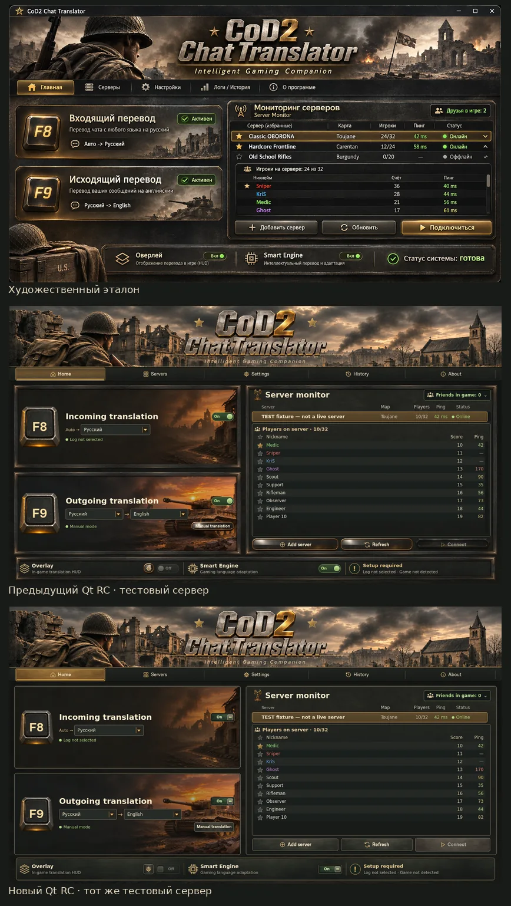
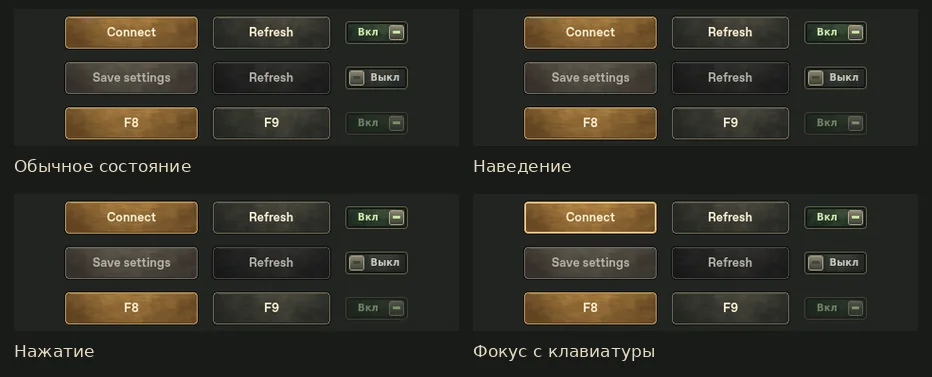
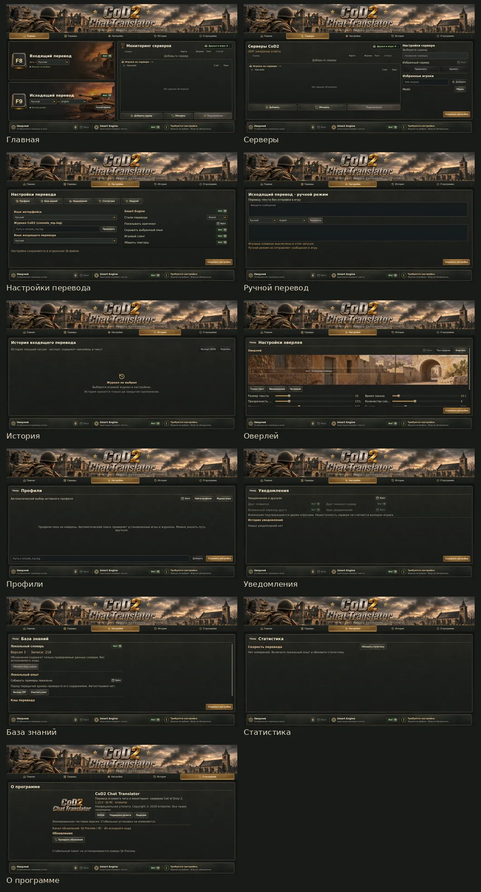

# CoD2 Chat Translator 1.22.0 · Qt RC

Ветка `experiment/qt-premium-game-ui`, [Draft PR #9](https://github.com/kriskarter/cod2-chat-translator/pull/9). Исходная версия для сравнения — `0a8041e26fb300b560af7f9335cf42ba5d979c01`. Точный коммит установщика, SHA-256 и результаты его Windows-сборки приведены в описании PR и публикации Qt Preview.

## Сравнение

Сверху расположен художественный эталон владельца. Под ним — снимки двух запущенных версий Qt Quick под Linux с одинаковым тестовым сервером и десятью игроками. Кнопка подключения на этих двух кадрах отключена, поскольку исполняемый файл игры отсутствует.

## Исправленные дефекты и проверка

| Область | Что было видно | Изменение и способ проверки |
|---|---|---|
| Янтарные кнопки | При высоте 36 границы текстуры занимали 18 + 18. У коротких кнопок центральный участок исчезал | Текстура 144×36, вертикальные и горизонтальные границы по 6, явно нулевые отступы поверхности. Тест измеряет фон, подпись и её вертикальный центр на 68×26, 140×36 и 392×44 |
| Обычные кнопки | Сильный белый блик, разные пропорции надписи и корпуса | Матовая сталь с ограниченным диапазоном яркости. Стандартный, основной, компактный, тихий и иконочный варианты используют одну разметку |
| Выключатели | Яркий круглый ползунок конкурировал с надписью | Стальной корпус со скошенным бегунком и световым окошком, раздельные активное, выключенное и недоступное состояния. Текст и клавиатурный ввод принадлежат Qt Switch |
| Рамки | Толстый профиль и яркие стыки повторялись на каждом уровне | Полая RGBA-рамка 64×48 с тонким кантом. Девятисегментные углы 8×8. Внутренние группы настроек используют лёгкую поверхность |
| Главная | Крупные клавиши, яркие детали фона под текстом, разная отделка навигации и действий | Скорректированы масштаб клавиш, свет на фоне и активный пункт меню. Нижняя панель получила собственную стальную фактуру, действие настроек оверлея — доступное имя |
| Мониторинг и друзья | Плюс для добавления по нику трудно распознать. Короткий список открывал широкое окно | Подписанное действие с иконкой. Размер списка зависит от количества друзей, ширина пустой панели уменьшена. Проверены тестовые состояния «онлайн», «не найден», «неизвестно», контекстное меню и уведомление |
| Настройки | Вложенные тяжёлые рамки и вытянутые кнопки навигации | Вторичная навигация ограничена по ширине. Последний параметр прокручивается над закреплённым сохранением. Геометрия проверяется на 1342×672 и других размерах |
| Профили | Путь подходил к краю карточки. Активный профиль выглядел кликабельным | Высота зависит от содержимого. Для пути применяется сокращение в середине, для текущего профиля — статус с галочкой. Ручной выбор и переименование доступны отдельно |
| База знаний | Подписи и переключатели оказались на противоположных краях широкой страницы | Колонка ограничена по ширине. Словарь, опыт и семидневный кэш разделены. Количество записей приходит из загруженного пакета |
| Статистика | Даже при пустых данных выводилась строка Total и пустые значения p50/p95 | Счётчик наблюдений отделён от измерений времени. Показаны количество, медиана и 95-й процентиль по имеющимся данным. Пустой список скрывается |
| Уведомления | Главный переключатель не выделялся, история сливалась с настройками | Главное действие занимает отдельную строку, зависимые элементы приглушены, журнал подписан. Подтверждение двумя опросами сохранено |
| Предпросмотр HUD | Слабая читаемость, широкие кнопки пресетов, выбранный режим не виден | Отдельная сцена деревни с контрастной надписью, перетаскивание и компактные пресеты. Выбор пресета вычисляется по реальным параметрам и снимается при ручном изменении |
| История и ручной перевод | В ошибках и времени встречались технические ключи или строки другого языка | Пользовательские названия исходов, локализованные единицы и ошибки. В историю попадают только события текущей сессии |
| О программе | Информация рассыпалась по ширине рабочей области | Центрированная колонка с назначением программы, версией, автором, лицензией и действующим каналом обновления |
| Служебная обратная связь | Сообщение о сканировании профилей оставалось на других страницах | Сообщение привязано к операции, исчезает по таймеру и при переходе. Ошибка сохранения и результат экспорта получают отдельную обратную связь |
| Диалоги | Заголовки и стандартные ответы зависели от оформления системы | Общая рамка и собственные кнопки подтверждения с языком интерфейса. Сохранены проверки подтверждения и отмены. Системный диалог выбора файла оставлен нативным |

## Галерея компонентов и страниц

Снимки кнопок и переключателей получены в работающей сцене Qt. В верхней строке изображены янтарная и обычная металлическая кнопки с включённым переключателем. Средняя строка показывает недоступные кнопки и выключенный переключатель. Нижняя строка показывает выбранное действие и недоступный включённый переключатель.

Сгенерированные материалы хранятся отдельно от снимков. [Лист металлических фактур](../assets/qt_art/source/instrument_metals.jpg) послужил основой для статических поверхностей. [Сцена для HUD](../qt_experiment/art/hud_village.jpg) изображает пустую деревенскую улицу. Это иллюстрация предпросмотра. [Подготовка ресурсов](../tools/build_qt_art_assets.py) запекает состояния кнопок и клавиш, слой рамки, две поверхности переключателя и металл нижней консоли. Готовые файлы можно рассмотреть в [галерее ресурсов](../qt_experiment/art).

## Границы проверки

Linux offscreen использует программную отрисовку. Снимки страниц и диалогов, замеры и проверка размеров выполнялись на запущенном приложении. Тестовые серверы и игроки используются только в материалах проверки. На Windows отдельный workflow проверяет собранный EXE, все страницы, языки, виртуальные масштабы, установку, переустановку, сохранение настроек и удаление. ZIP со снимками доступен в артефактах соответствующей сборки.

Игровые F8/F9/F10, отправка по Enter, потеря фокуса, оверлей, звук и FPS в оконном и полноэкранном CoD2 требуют проверки на установленной игре. Физический DPI монитора, загрузка GPU и результат на ноутбуке владельца остаются открытыми. Для установки обновления требуется явное подтверждение пользователя. Художественная приёмка остаётся за владельцем.

## Проверка игровых клавиш

Каталог установленных игр распознавал `cod2_mp.exe`, но проверка активного окна для игровых клавиш пропускала это имя. Список имён теперь общий. Подключение клавиатуры происходит после создания интерфейса. F9 при открытии размещает поле ввода в пределах монитора активной игры. В разделе ручного перевода можно посмотреть последнюю принятую игровую клавишу или ошибку инициализации. F8 скрывает или показывает входящий оверлей, F9 открывает исходящий ввод, F10 сохраняет скриншот. Проверка установленного EXE ожидает подтверждение от реального Win32-обработчика без имитации нажатий. Причину на конкретном игровом компьютере можно подтвердить только в его конфигурации.

## Производительность

Замеры предыдущей и новой художественной версии проводились под Linux с программной отрисовкой. В серии из четырёх запусков время процесса до сохранённого кадра составило 725–810 мс до изменений и 654–756 мс после. При открытом окне RSS вырос с 213,9 до 221,8 МиБ. CPU в простое составил 0,7% и 1,1%, при сворачивании 0,5% и 0,9%. В тесте с отрисовкой кадра p95 переключения страниц составил 34,7 и 33,9 мс, прокрутки — 3,2 и 2,7 мс, обновления состава игроков и присутствия друзей на локальных данных — 14,6 и 12,1 мс. Эти замеры сделаны до последующего исправления игровых клавиш. Задержка реального UDP-сервера, аппаратная нагрузка GPU и изменение FPS в CoD2 не измерены.
