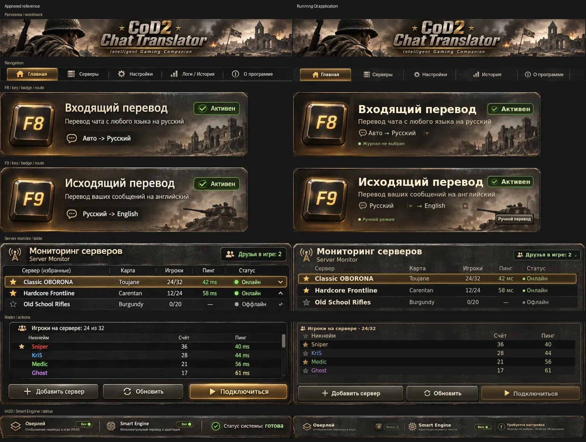

# CoD2 Chat Translator · проверка реконструкции Qt RC

[Единственный художественный эталон](https://github.com/kriskarter/cod2-chat-translator/blob/f55bb7d5700a2ad81c555e4505416e1a4589a88d/docs/images/server_monitor_rc/reference.png) имеет размер 1536 × 864. Верхние 34 пикселя занимает системная рамка. Все сравнения ниже используют клиентскую область 1536 × 830. В таблице приведены координаты x, y и размеры w × h, снятые с элементов работающей сцены.

| Компонент | Эталон | Qt, Linux offscreen |
|---|---|---|
| Панорама | 0, 0 · 1536 × 198 | 0, 0 · 1536 × 198 |
| Навигация | 0, 198 · 1536 × 50 | 0, 199 · 1536 × 50 |
| F8 | 17, 277 · 650 × 170 | 17, 277 · 650 × 170 |
| F9 | 17, 468 · 650 × 170 | 17, 469 · 650 × 170 |
| Монитор серверов | 680, 262 · 841 × 436 | 680, 263 · 841 × 435 |
| Нижняя панель | 287, 712 · 1235 × 95 | 287, 712 · 1234 × 94 |

[Исходная сборка cb22d14](images/reference_restoration/before.webp) · [реконструкция](images/reference_restoration/final.webp) · [11 страниц приложения](images/reference_restoration/pages.webp)

Для обеих версий использованы одинаковые локальные записи серверов и игроков. Управление остаётся активным. В фикстуре нет подключённой игры, журнала или работающего HUD, поэтому в нижней панели видны соответствующие статусы. Выбор языков, ручной F9 и настройки HUD доступны из главного окна. Геометрия мелких элементов и метрики системных шрифтов могут отличаться между Windows и Linux. Пиксельный критерий общей идентичности не применяется к динамическим текстам и состояниям.

Панорама разделена на три фрагмента, чтобы центральная надпись сохраняла пропорции. Клавиши, бортики, поверхности кнопок, иконки, засветка и световые индикаторы взяты из оригинала. Для участков под надписями и переключателями на двух карточках использована генеративная реставрация. Сценические иллюстрации размещены за интерактивными QML-кнопками. Нижний декоративный натюрморт исключён. У F10 нет отдельной карточки.

Тест `test_qt_reference_capture.py` снимает окно Qt с одинаковой фикстурой и проверяет шесть областей. В Windows CI файлы `reference_client_ru.png` и `reference_components.png` включены в архив `qt-preview-frozen-ui-evidence` вместе со скриншотами установленного приложения, страниц замороженного EXE и диалогов.

## Проверка игровых клавиш и уведомлений

В RC cb22d14 у трея отсутствовал обратный вызов Windows для обработки кликов. Новый обработчик поддерживает двойной щелчок, контекстное меню и переход из уведомления в панель друзей. Появление уведомления само по себе не активирует окно. Для нескольких запусков интерактивного Qt RC используется одна сессия на пользователя. Параллельно запущенный старый Tk-переводчик фиксируется в диагностике при наличии распознаваемого имени процесса.

В Tk F8 независимо опрашивается через GetAsyncKeyState. В прежней реализации Qt все три действия зависели от WH_KEYBOARD_LL и проверки игрового фокуса. В RC сохранён основной hook и добавлена независимая проверка состояния трёх клавиш. Если Qt обнаружит пропущенный F9, он переустановит hook до открытия поля. Принятый hook и опрос дедуплицируются для удерживаемой клавиши.

В разделе ручного перевода есть кнопка «Открыть журнал клавиш». Путь по умолчанию — `%APPDATA%\CoD2ChatTranslatorQtPreview\game-hotkeys.log`. Ротация — два файла до 128 КиБ каждый. Журнал фиксирует установку, события F8/F9/F10, флаг injected, решение проверки фокуса, имя процесса при диагностике нажатия, доступность сведений о повышении привилегий, обработку очереди Qt и результаты действий. Отдельный поток пишет запись Win32 даже при занятом цикле Qt. Обычный ввод, текст чата и заголовки окон в журнал не попадают.

Автотест Windows вызывает зарегистрированный Win32 callback с контролируемыми данными и передаёт события в обработчик Qt. Тест трея проверяет адресацию событий оболочки и выбор действия. Для подтверждения аппаратного ввода необходима запись нажатия на машине с игрой. Компьютер KRIS-KARTER был офлайн во время диагностики. Причина отказа на этой машине остаётся открытой.
