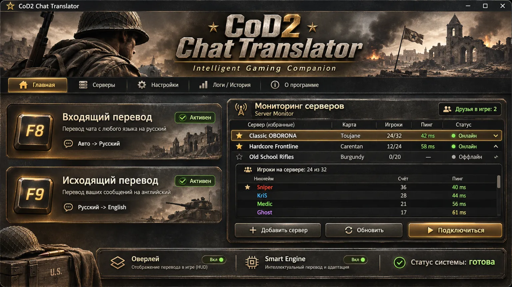
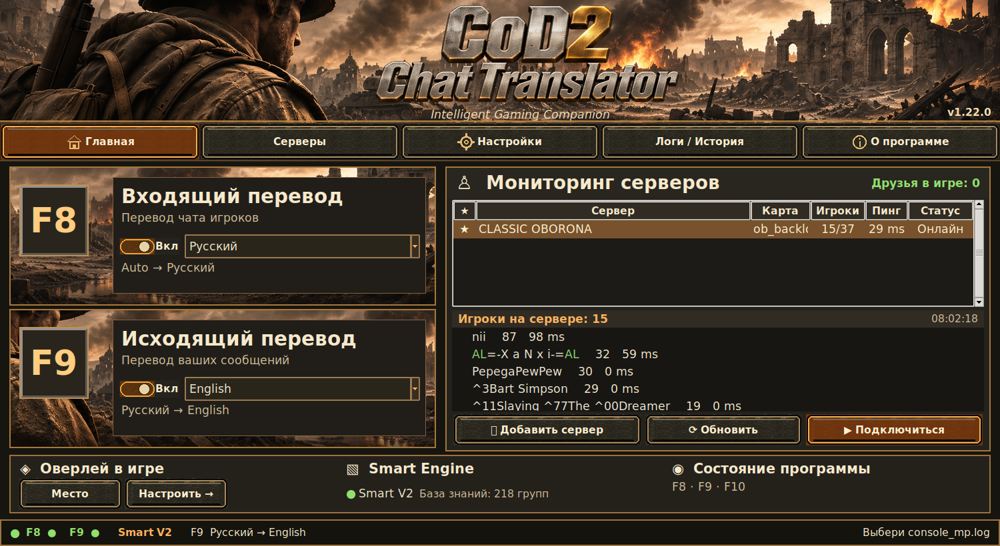

# CoD2 Chat Translator 1.22.0 RC — Server Monitor

## Approved composition and real app

| Owner-approved target | Running Tk application, 1500×820 under Linux Xvfb |
|:---:|:---:|
|  |  |

The left F8/F9 bays and the server/player table use live controls. The target
image contains illustrative player/server values; the application never ships
those values. The server rows and player roster in the right screenshot came
from a UDP query to CLASSIC OBORONA during the capture.

Additional running views: [Servers](images/server_monitor_rc/xvfb_servers.png),
[Translation](images/server_monitor_rc/xvfb_translation.png),
[Overlay](images/server_monitor_rc/xvfb_overlay.png),
[Knowledge](images/server_monitor_rc/xvfb_knowledge.png),
[Statistics](images/server_monitor_rc/xvfb_stats.png),
[Settings](images/server_monitor_rc/xvfb_settings.png),
[History](images/server_monitor_rc/xvfb_history.png),
[Add Server dialog](images/server_monitor_rc/xvfb_dialog_add_server.png),
[game profile dialog](images/server_monitor_rc/xvfb_dialog_server.png),
[knowledge dialog](images/server_monitor_rc/xvfb_dialog_knowledge_dialog.png),
[About dialog](images/server_monitor_rc/xvfb_dialog_about.png).

## Behavior

- Uses the CoD2 Quake 3 UDP `getstatus` query, falling back to `getinfo`.
  No game process, RCON password, paid service, or VPS is required for a
  player's installation.
- A dedicated daemon worker reads at most 32 configured servers. Refresh
  interval is selectable from 30 to 600 seconds; manual refresh wakes it.
  Queries never run on Tk's event loop or translation workers.
- `online` means a full status reply; `limited` means only server data
  were returned; `offline` means no valid response. A server with a valid
  empty player list is shown as online with zero players. Last successful
  response time remains visible when subsequent polling fails.
- Server addresses, labels, stars, favorite nicknames and notification
  preference live in the existing atomic/backed-up config. Existing
  `server_profiles` (translation log profiles) are separate.
- Nickname matching strips CoD color markup and ignores case. A match
  identifies a nickname observed on a server, not a verified person.
  Notifications are disabled by default, start after an initial baseline,
  and have a ten-minute cooldown per nickname/server.
- The Windows shell tray balloon is used for enabled friend notifications.
  Desktop policy may suppress banners; no notification is sent on Linux.

## Verification limits

Local protocol/parser/config tests and Linux Xvfb smoke/screenshots verify the
working Tk application; Xvfb scaling is only a proxy for Windows DPI. The
owner's Windows device was offline at test time. Native Windows rendering,
notifications, game launch, F8/F9/F10 in a real CoD2 session and overlay
position require manual Windows acceptance. The feature branch/PR stays
unmerged until the owner approves the visual result.
