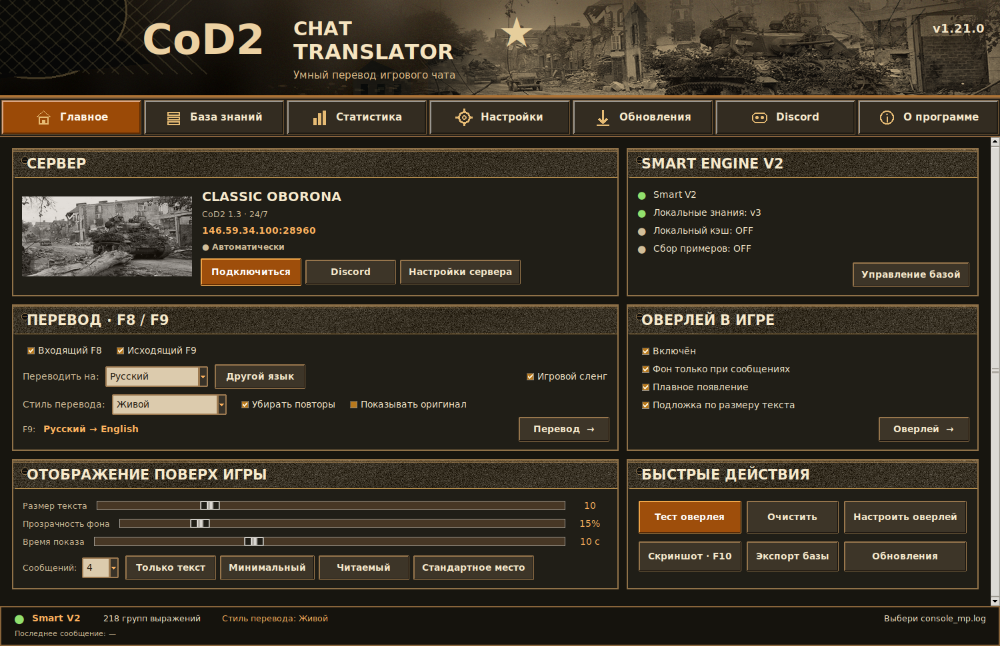

# CoD2 Chat Translator v1.21.0 RC — WWII metal rebrand

The user rejected the flat blue/graphite v1.20.0 dashboard and chose the
SECOND, cinematic WW2/CoD2-inspired concept as the approved direction.

## Real functionality and design

- Archival U.S. Army photo background of 1944 ruins and armored vehicles,
  textured bronze metal plate headings, dark leather-like panels, amber
  accent buttons, and original HUD-style logo, no fake telemetry.
- Seven-item horizontal real navigation: Home, Knowledge, Statistics,
  Settings, Updates, Discord and About. Focusable navigation buttons with
  actual icon sprites, so no unsupported Unicode placeholder glyphs.
- Home with six required real blocks: Server / Smart Engine / F8 & F9 /
  In-game Overlay / Overlay appearance / Quick Actions.
- Dedicated original advanced pages: Translation, Overlay, Knowledge,
  Statistics and Settings remain operable from main actions.
- F8/F9, smart slang/style, quick-connect, game overlay presets/sliders,
  F10 screenshots, data export, language switching and updater remain
  bound to original app.py state/callbacks; no replacement backend.
- Server preset is not a claim of network connectivity. Engine, cache,
  collection status and knowledge pack version are read from real runtime.
- RU/UK/EN support, keyboard focus and scrolling on smaller windows;
  initial window dimensions bounded by reported screen size.

## Tests and release policy

The screenshot is an ACTUAL Tk running application in isolated Xvfb,
not a drawn mockup. Unit tests include UI contract and asset checks. Real
GUI smoke navigates all pages, checks local persistence toggles and overlay,
switches RU/UK/EN and tests 1050x690 plus 1500x970 geometry.

Manual Windows / CoD2 tests are mandatory for native DPI, game focus,
F8 overlay, F9 sending, F10 screenshot, server launch and knowledge
export. This candidate does NOT claim to fix internet translation delays.
Stable main and prior public releases are not modified.

Image provenance is recorded in assets/ui_wwii/README.md.
