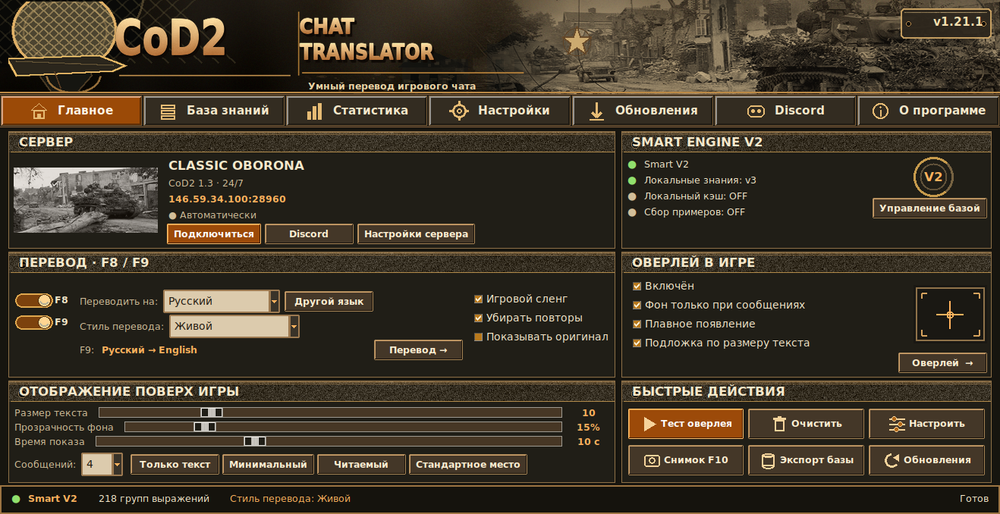
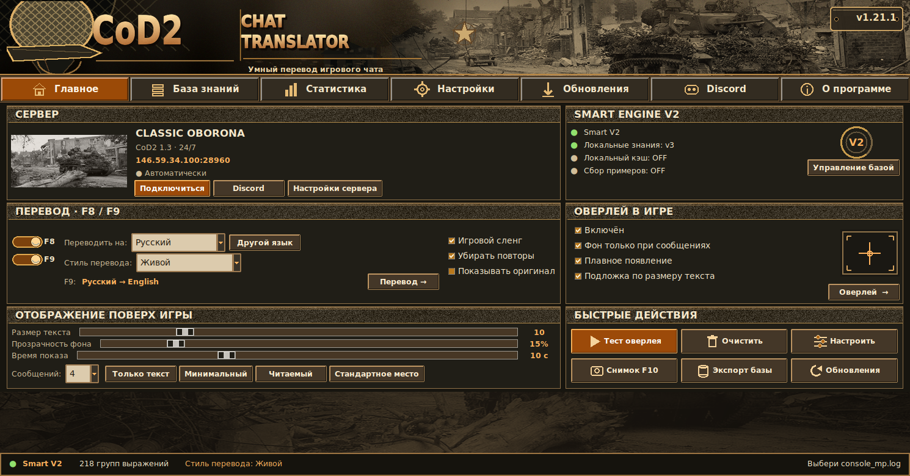

# CoD2 Chat Translator v1.21.1 RC — visual refinement of approved WWII concept

The owner asked for a significantly more faithful and compact realization of
the second approved cinematic WWII picture after reviewing the real 1.21.0
screenshots. The previous working 1.21.0 remains preserved as RC2.

## Screenshots from actual running Tk desktop application

Compact 1318 × 678 window, corresponding to a practical client area on a
1366 × 768 display:

Larger 1490 × 780 window with the actual background artwork:

These images are captures of the executable UI under isolated Xvfb/Tk, not
illustrations or a simulated HTML page. There is no fictional ping, FPS or
connected-server label, and user files or Telegram content are never uploaded.

## Changes from 1.21.0

- A separate illustrated and rendered metallic CoD2 / CHAT TRANSLATOR wordmark
  with a WWII netted steel helmet, sepia title and a real-version metal badge.
- The original six live panels now use shorter card headers and tighter spacing
  with native interaction. More compact server photo, Smart Engine status and
  genuine F8/F9 toggle visuals, plus original crosshair preview.
- 6 quick actions now include icon sprites. Short RU/UA/EN button labels avoid
  clipping on narrower windows; no destructive command is renamed to an
  unrelated cache clear action.
- Correct F8 source target and F9 actual route are shown separately. Live
  style/slang/original/duplicate checkboxes and real overlay sliders/message
  count/presets preserve the original callbacks and persistence.
- At 1318 × 678, all six panels fit in the tested viewport with no visible
  scrollbar. Longer pages remain scrollable at small windows or high text size.
- 7 horizontal buttons remain real keyboard-focusable Tk controls, with
  adjusted navigation font sizes at larger Tk DPI scaling.
- On taller windows the surplus area shows a faint historical photograph
  wallpaper rather than an unstyled blank region.
- Current engine state, pack version, cache and collection flags are read from
  actual runtime, not fake concept-art green status indicators.
- Version 1.21.1 is a RELEASE CANDIDATE, not stable main.

## Technical architecture

All art is generated or composited by tools/build_wwii_assets.py. Sources,
public-domain U.S. Army photo provenance and lack of bundled third-party fonts
are documented in assets/ui_wwii/README.md. All interactive elements are
real Tk/ttk controls. Runtime does NOT require Pillow. PyInstaller bundles
the PNG assets through its existing --add-data assets rule.

The design is implemented in wwii_dashboard.py and the shared metal theme
in dashboard_ui.py. The existing translation, game hooks, servers, ovelay,
local knowledge, data updates and optional local experience persistence are
intentionally not rewritten.

## Verification gates

- Full Python tests, including semantic safety and offline reference routes.
- Real Xvfb/Tk UI navigation, RU/UA/EN switches, native F8/F9 and knowledge
  controls, overlay editing and settings persistence.
- Run 1318 × 678 and assert the main Home panel entirely fits.
- Run 1490 × 780 with Tk font scaling probes approximating different DPI.
  These are NOT proof of native Windows 100/125/150% compatibility.
- Windows GitHub Actions must build exact SHA and installer. Then actual
  installation and Call of Duty 2 gameplay must check F8/F9, hotkeys,
  fullscreen overlay, profile selection, F10, updates, DPI, ZIP exports.
- Release stays DRAFT until user visually confirms and approves a stable
  merge. Stable main remains unchanged.
