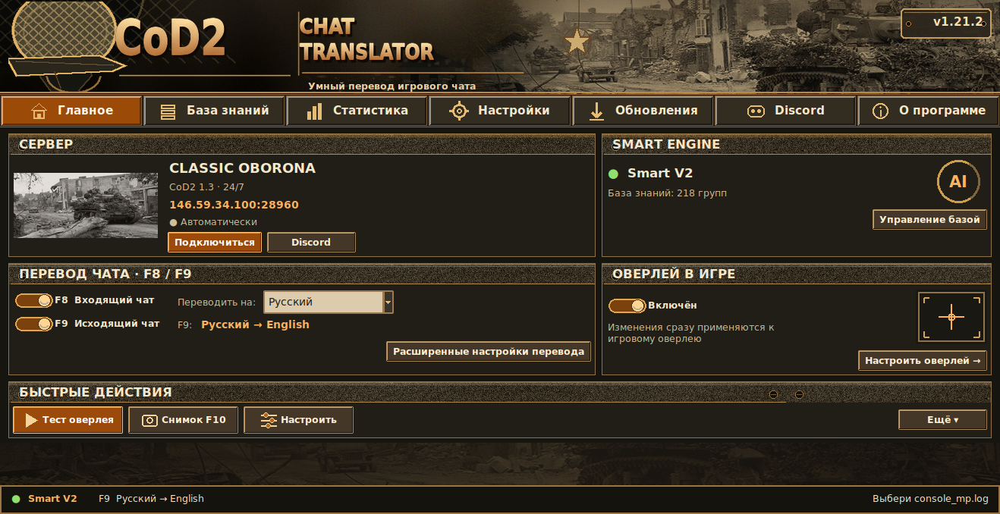

# CoD2 Chat Translator v1.21.2 RC — beginner-first compact Home

The owner approved this behavior: the app should work using previously
configured defaults for newcomers, while experienced players should be
able to reach every advanced option. The interface must NOT reset or overwrite
saved settings simply because the user opens Home.

## Simple Home — five sections

- Server: current featured server and profile (not an invented online
  status), real Connect and Discord actions. Profile management remains
  under Settings.
- Smart Engine: actual current mode, loaded knowledge group count,
  access to Knowledge. Cache/collection detail is on the Knowledge page.
- F8/F9 translation: independent native F8 and F9 on/off controls,
  incoming F8 target-language selector, current outgoing F9 route, and
  Advanced Translation button. The expert Translation page still holds
  source/target selection, style, slang, deduplication and original-display
  options.
- Overlay: current enabled state and decorative crosshair preview,
  real link to the existing Overlay page containing all sliders,
  appearance presets, message count, background/fade controls and positioning.
- Quick actions: Test Overlay, Screenshot F10, Configure, and native
  More menu with Clear Overlay, Export Knowledge ZIP, Check Updates.
  All actions reuse their original callback; Clear Overlay is not
  misrepresented as clearing the translation cache.

## Preserving user settings and abilities

No automatic configuration or learned phrase database reset. A change on
the real Home controls persists by using the same callbacks and BooleanVar
bindings as the previous RC3. The original Windows game overlay and F9
keyboard hooks are not rewritten, and the default behavior remains subject
to the actual saved configuration.

The seven-item horizontal WWII navigation remains. About, statistics,
knowledge, general settings, updates and Discord retain original behavior.
All visible and advanced UI content is available in RU, UK and EN.

## Test evidence and limits

- GUI smoke uses real Tk widgets in isolated Xvfb and confirms compact Home,
  all six pages, language switching, server/overlay navigation, actual
  F8/F9 control invocation, knowledge opt-in, Overlay settings and More menu.
- The 1318x678 basic-font window fits Home without scrolling; additional
  high-Tk-scaling tests check content accessibility.
- Unit regression and semantic safety/translation reference tests must pass.
- The Windows RC installer must build on the exact branch SHA.
- No claim of actual Windows DPI compatibility or in-game translation
  quality until tested by the owner in Call of Duty 2.
- Stable main and public releases stay untouched. This RC is a draft PR
  stacked on v1.21.1 RC3 until visual and functional acceptance.

## Artwork

Original logo, metal panel imagery and the historic public-domain 1944
Coutances photo are documented in assets/ui_wwii/README.md. The screenshot
is a real running Tk application, not an image-based interactive fake.
