# Gallery

### Home

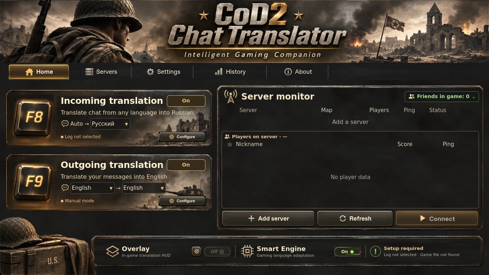

### Servers

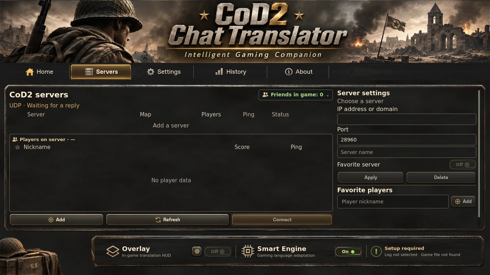

### Add server

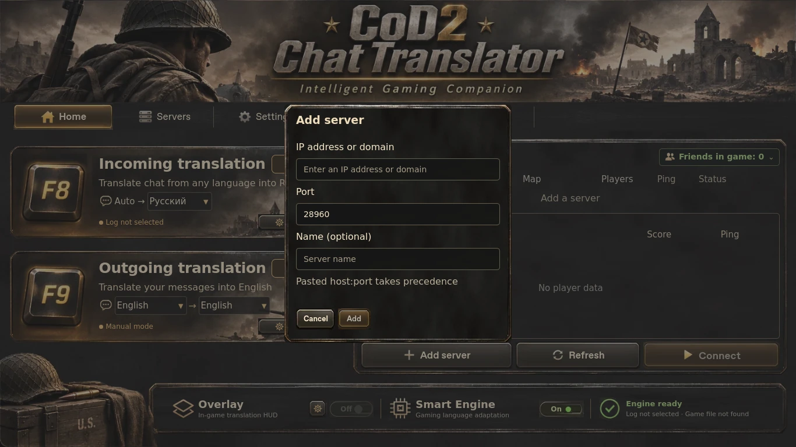

### Settings

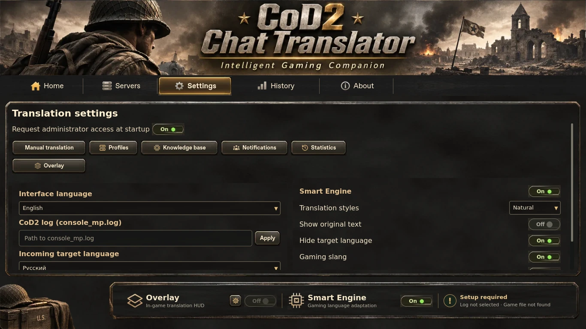

### Incoming HUD

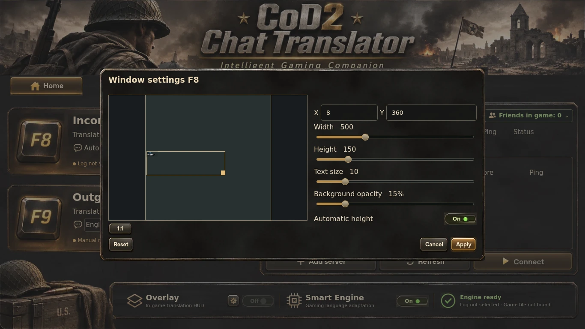

### Outgoing HUD

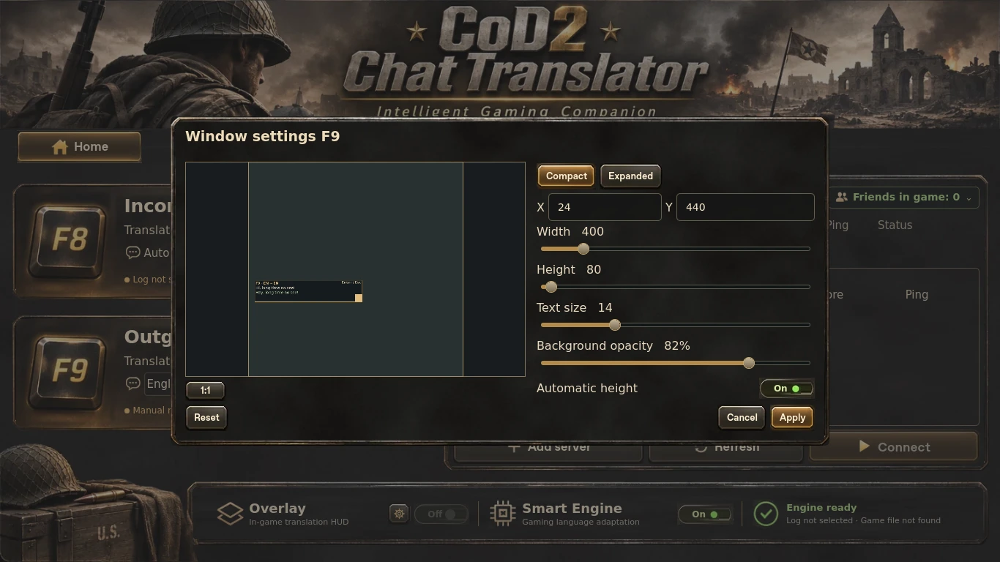

### Compact F9 preview

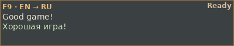

### Expanded F9 preview

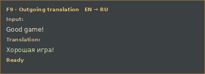

### History

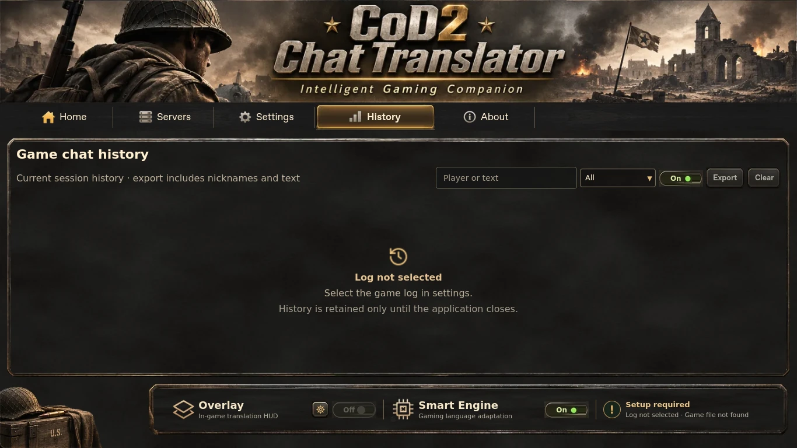

### Friends

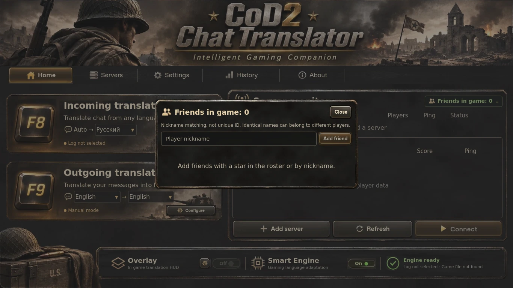

### Notifications

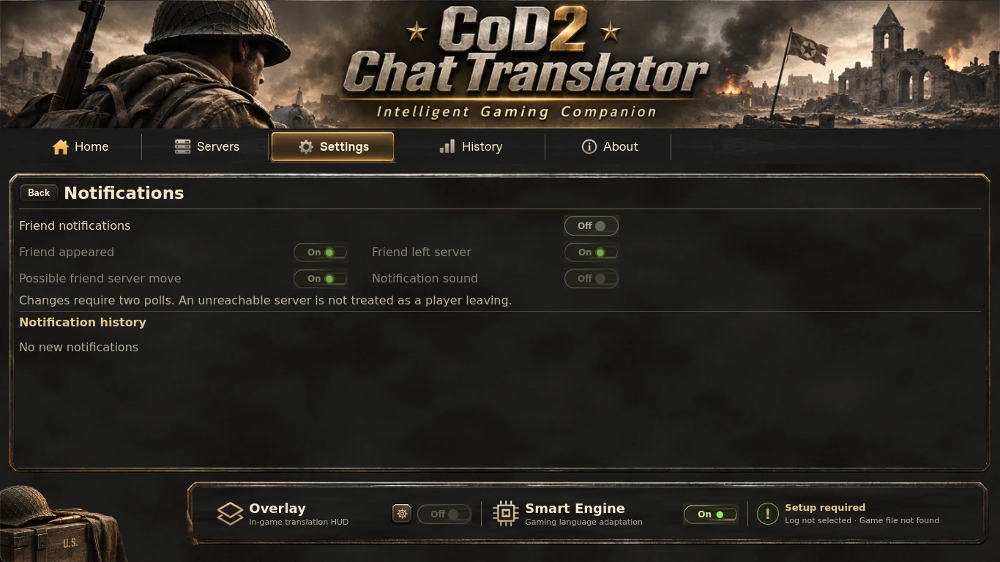

### About

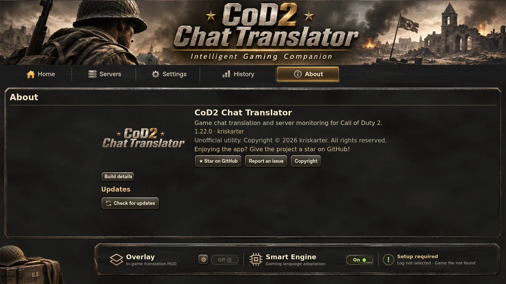

### Windows installer

### Installation complete

