# Галерея

### Главная

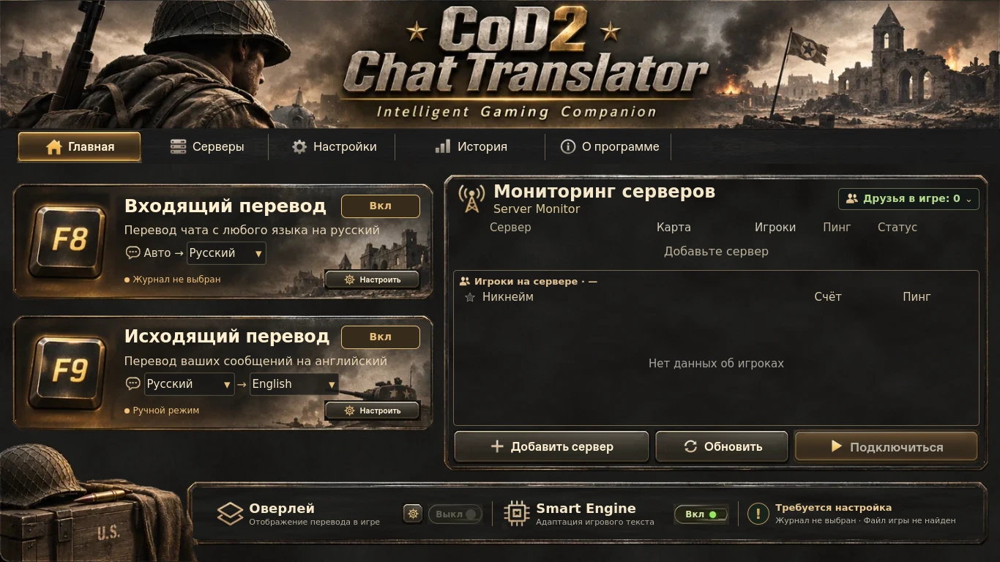

### Серверы

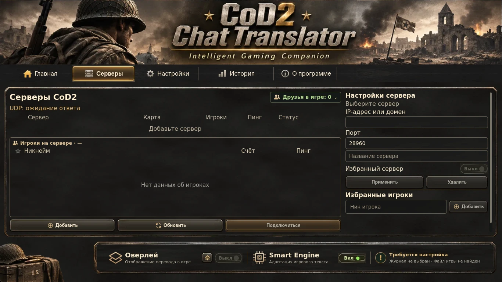

### Добавление сервера

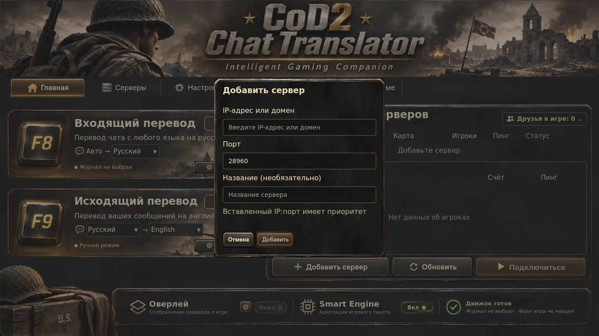

### Настройки

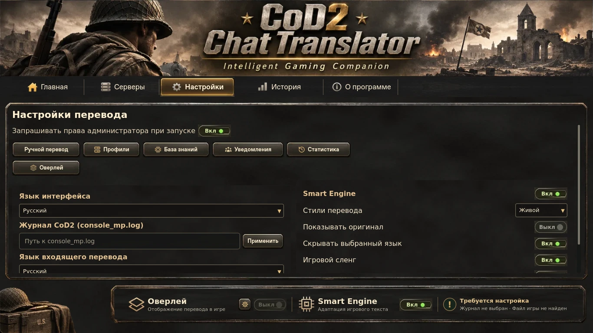

### Входящее окно

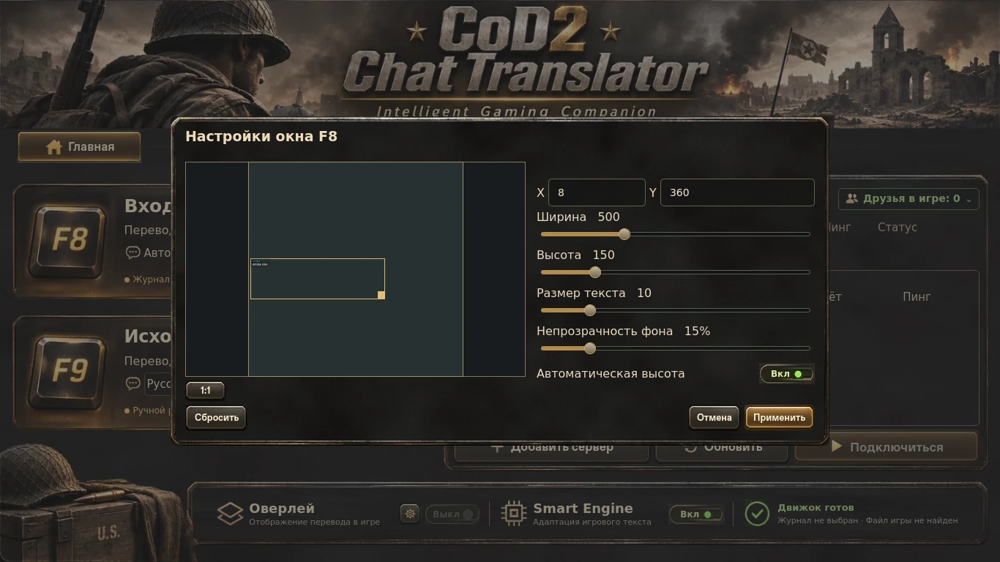

### Исходящее окно

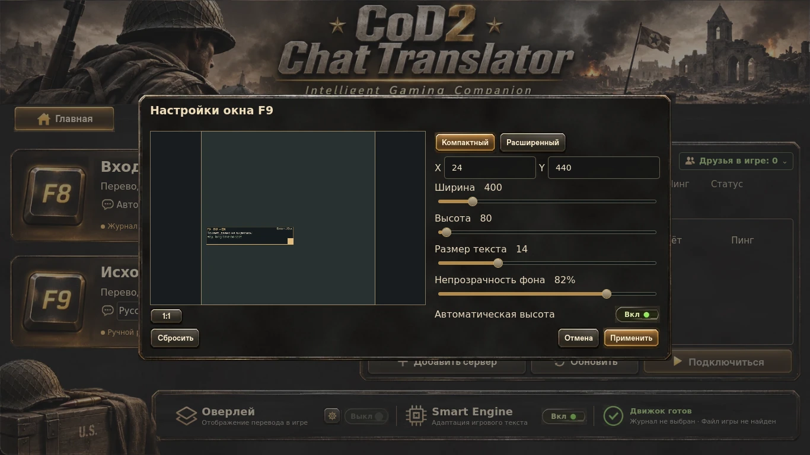

### Предпросмотр компактного F9

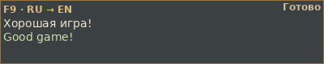

### Предпросмотр расширенного F9

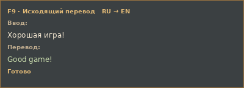

### История

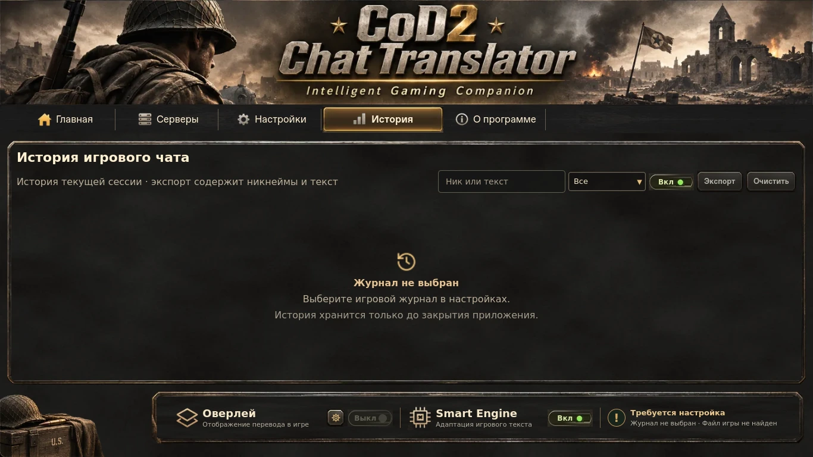

### Друзья

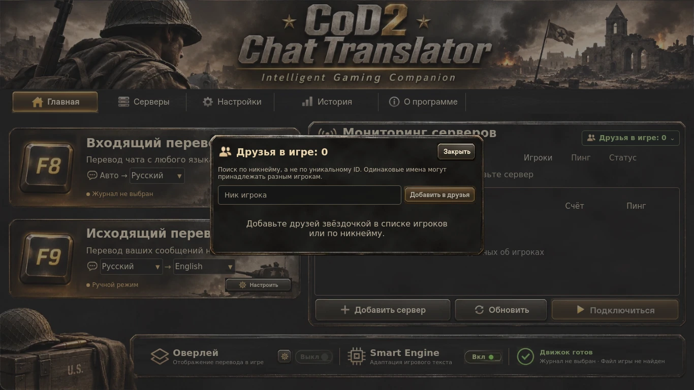

### Уведомления

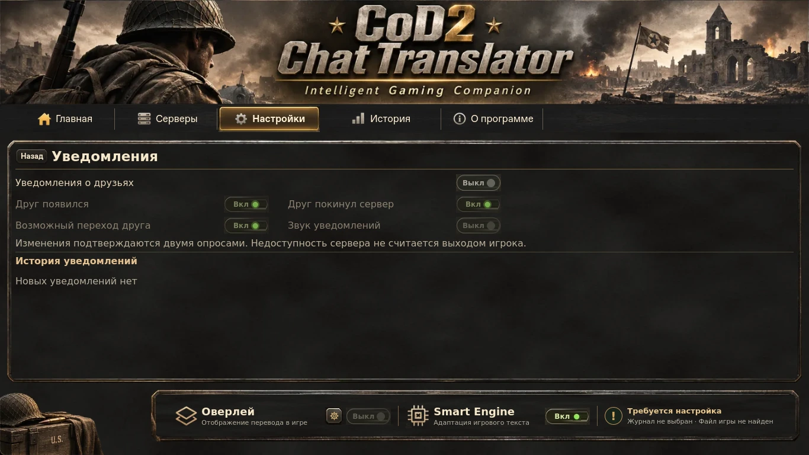

### О программе

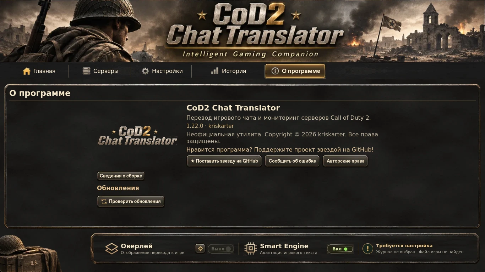

### Установщик Windows

### Завершение установки

