# Галерея

### Головна

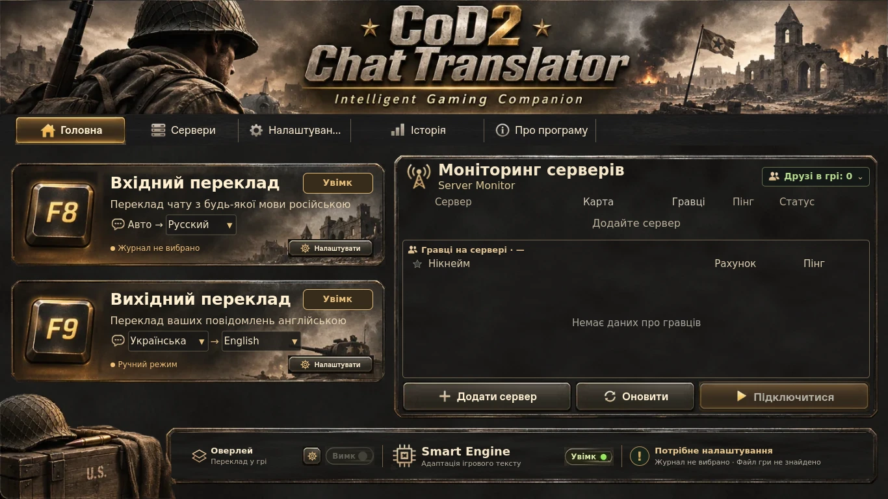

### Сервери

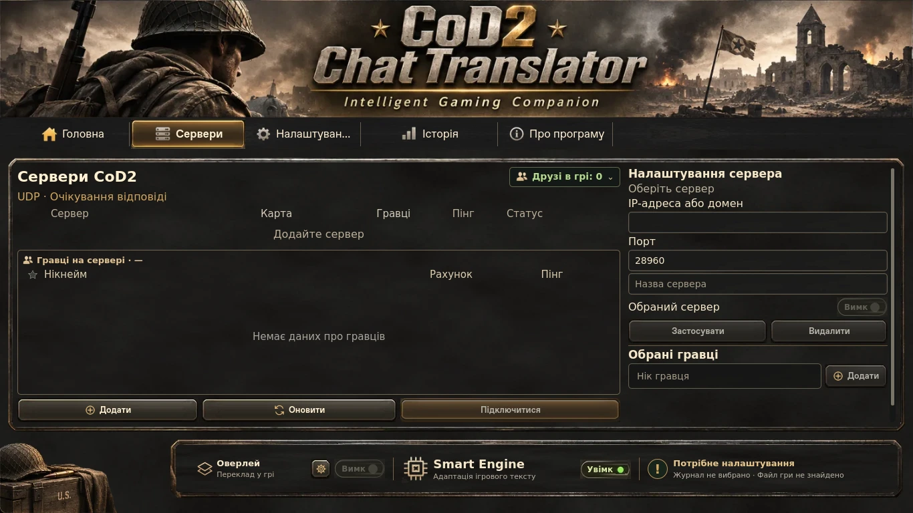

### Додавання сервера

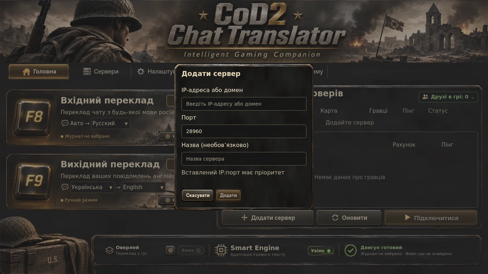

### Налаштування

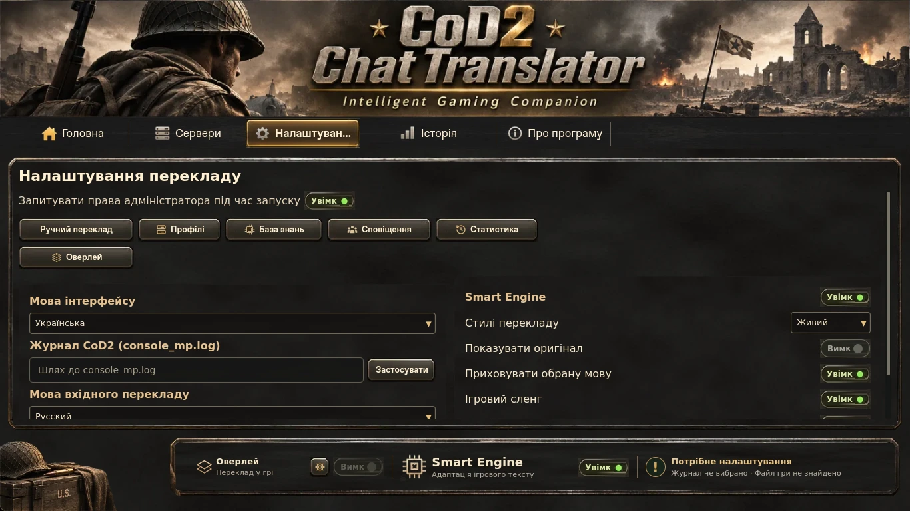

### Вхідне вікно

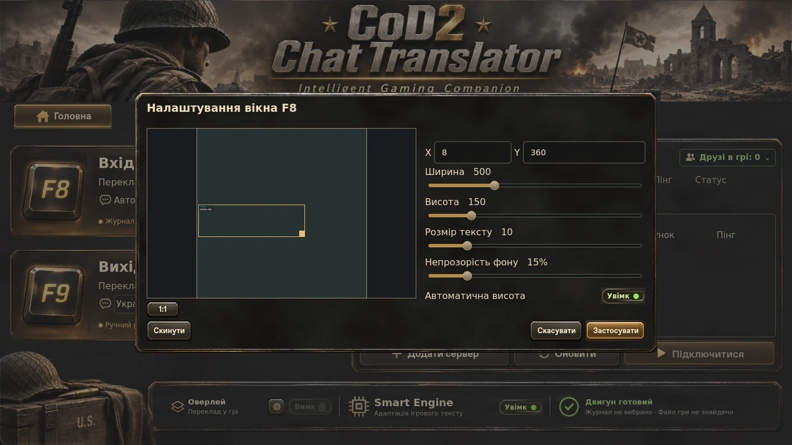

### Вихідне вікно

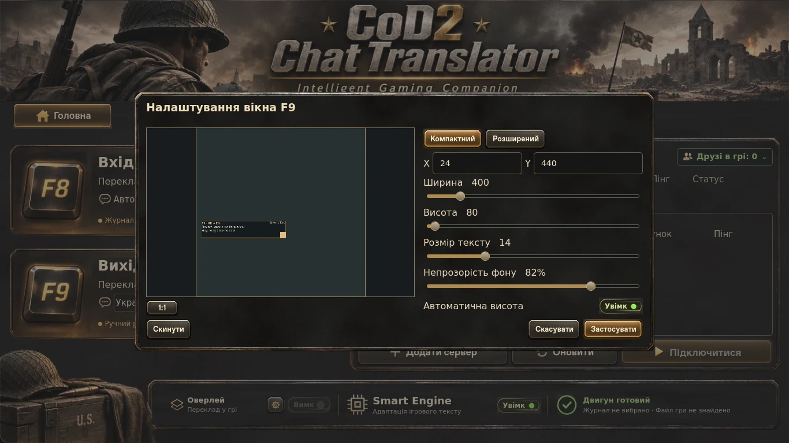

### Попередній перегляд компактного F9

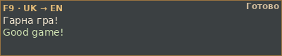

### Попередній перегляд розгорнутого F9

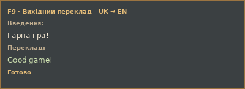

### Історія

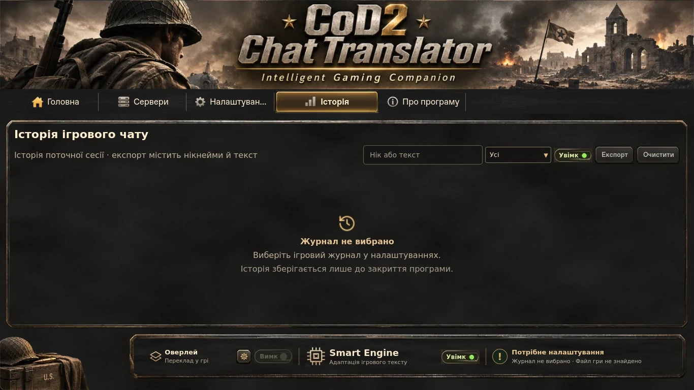

### Друзі

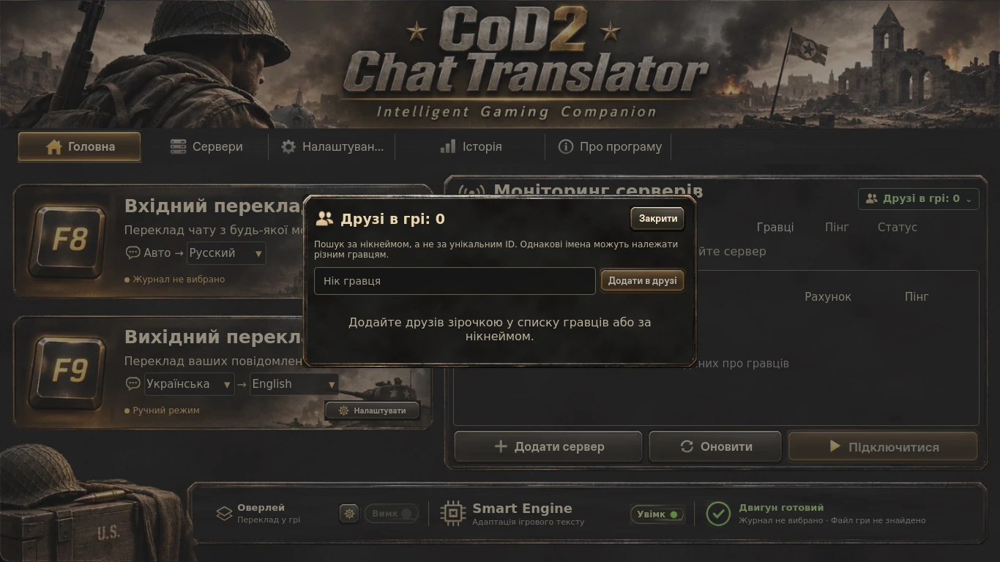

### Сповіщення

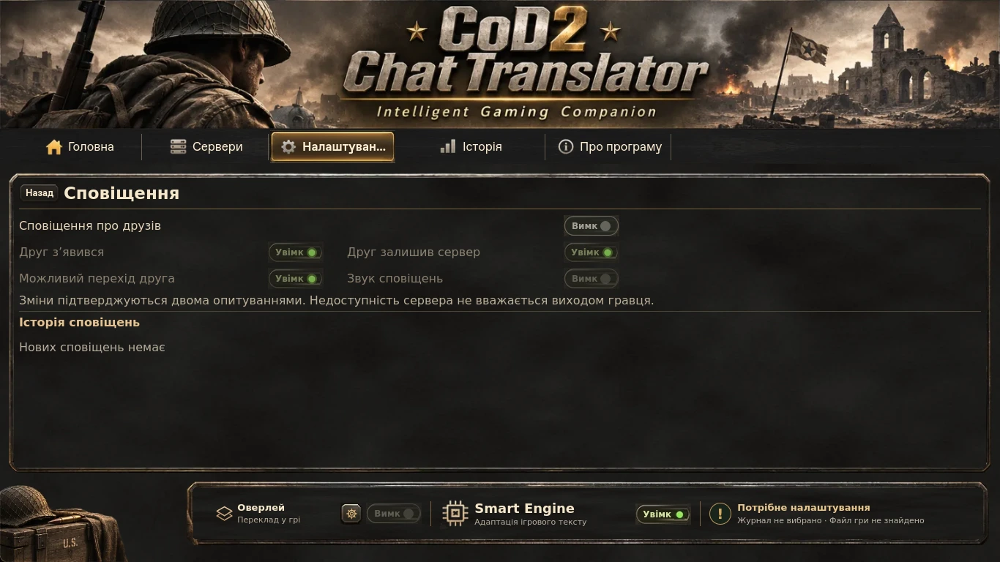

### Про програму

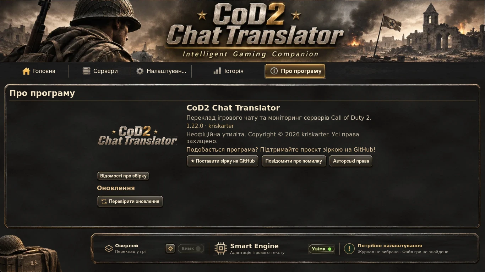

### Інсталятор Windows

### Завершення встановлення

### База знань і локальний досвід

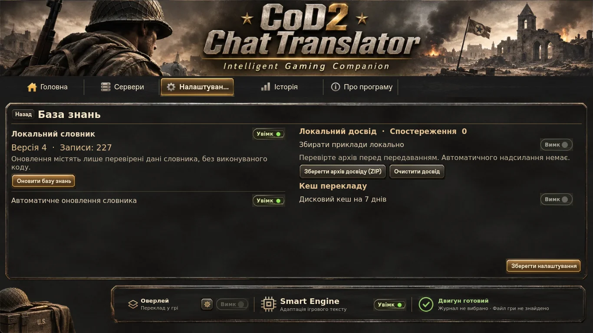
